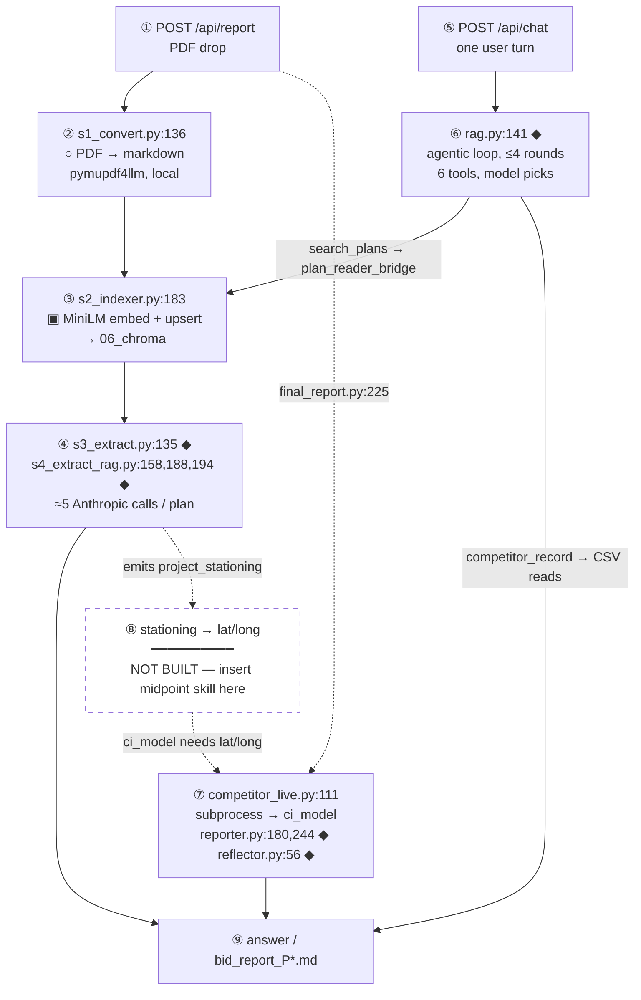

# CSI Bid Intelligence — System Architecture

**Audience:** Mochen (faculty advisor). **Scope:** the whole system, not one branch.

Every path and line number below was read off the current tree and verified with `git ls-files`.
Where behaviour could not be determined by reading the code, the row says **UNVERIFIED** rather than
guessing.

Every column except `Job — why` is derived from the code and verified against it. The `Job — why`
column is the design intent behind each step, written by hand rather than read off the source.

---

## 1. The call sequence — where every external call happens

This is the centre of the document. **The question it answers is "where is the API call, and when?"**

The system has **two entry points**, and they do different things. Every external call below is
marked in place. `○` = pure file transform, no call. `▣` = **local** model, no network.
`◆` = **external Anthropic API call**.



### 1.1 Path A — the PDF drop (`POST /api/report`)

Driven by `apps/api/backend/report.py::process_pdf` (`:76`). The CLI equivalent is
`pipelines/plan_reader/run.py`.

| # | Stage | File : line | Call type |
|---|---|---|---|
| 1 | Convert PDF → markdown | `s1_convert.py:136` (`pymupdf4llm.to_markdown`), pdfplumber back-fill `:161` | `○` pure |
| 2 | Detect document type | `lib.py:450-487` (`detect_doc_type`) → `addendum` / `plan_set` / `proposal` / `contract_forms` | `○` pure |
| 3 | Section + chunk | `s2_indexer.py:119` → `lib.page_sections` (`lib.py:363`) | `○` pure |
| 4 | Embed + store | `s2_indexer.py:183` `collection.upsert` | `▣` **local** MiniLM (`lib.py:206`), writes `06_chroma` (`lib.py:52`) |
| 5 | Whole-doc extract | `s3_extract.py:135` `client.messages.create` | `◆` **1 call**, `claude-sonnet-4-6`, `temperature=0` |
| 6 | RAG extract — scalars | `s4_extract_rag.py:188`, preceded by retrieve at `:187` | `◆` **3 calls** (3 query groups, `:36-46`) |
| 7 | RAG extract — special reqs | `s4_extract_rag.py:194`, retrieve at `:193` | `◆` **1 call** |
| 8 | RAG extract — gotchas | `s4_extract_rag.py:158`, retrieve at `:154` | `◆` **1 call** over the 20-type taxonomy |

**≈5 Anthropic calls per plan**, all through one shared client (`s3_extract.py:131`).

**Why stage 6–8 exist at all:** `s3_extract` truncates the document — `smart_truncate`
(`s3_extract.py:83-92`) keeps the first 60% and last 40% and **drops the middle**, which is exactly
where mid-document fields live. Stages 6–8 recover those fields by retrieving first, then grounding
the model in the retrieved excerpts.

**Retrieval is not an API call.** `retriever.retrieve` (`retriever.py:50`) runs
`collection.query(...)`, and MiniLM embeds the query **locally** inside that call. The only network
egress in the whole retrieve step is the synthesis call that follows it.

**The document-type branch — what is actually true.** Doc-type branching exists in the **ingest**
layer only (`lib.py:450-487`, consumed at `lib.py:375`, `:601-606`, `:609-614`). It does **not**
branch any prompt: `s3_extract.py` and `taxonomy.py` contain zero occurrences of `doc_type`, and one
prompt serves every document type. Two caveats worth stating rather than hiding:

- **The doc_type axis is wired but unpopulated.** `disposition_for` and `relevance_for` do
  exact-then-wildcard lookup against `05_knowledge/section_taxonomy.csv`, and **all 18 rows in that
  file carry `doc_type = "*"`**. Every lookup resolves through the wildcard today. The mechanism is
  built; the data has not been specialised.
- **`s4_extract_rag.py:186` is dead code.** The `map_pages` restriction fires only when a field
  declares `doc == "plan_set"`, and **no field in `schema.py` does** — `traffic_level`, which its own
  docstring (`:179-181`) names as the motivating case, is `doc="either"` at `schema.py:85`. The
  `map_pages` argument threaded in from `run.py:129` and `report.py:115` is therefore always
  discarded.

**Fallback behaviour on this path.** A malformed model response is caught at `s3_extract.py:140-144`
and returns `None`; every field then degrades to the empty cell at `s3_extract.py:110-111`. An
outright API failure is caught at `report.py:116`, classified by `_classify_read_error`
(`report.py:55-73`), and surfaces to the user as **`read_error` — "may be corrupt or an unsupported
format."** That message is misleading: an Anthropic outage is reported as a bad PDF. Non-fatal, but
it points the user at the wrong cause. `--no-llm` skips stages 5–8 entirely (`run.py:121`) while
still writing a row of empty cells (`run.py:138`).

### 1.2 Path B — one chat turn (`POST /api/chat`)

`apps/api/app.py:128-129` → `rag.py::agentic_answer` (`:100-192`). One `◆` call per round at
`rag.py:141`, up to `_MAX_STEPS = 4` (`rag.py:29`). The model picks tools; the code does not.

**A single turn reaches both subsystems** — this is the join:

| Tool | Reaches | How | Call type |
|---|---|---|---|
| `search_plans` | **plan_reader** | `tools.py:55` → `plan_reader_bridge.retrieve` (`:35`) → `retriever.retrieve` (`retriever.py:50`) | `▣` local embed against `06_chroma` |
| `competitor_record` | **the CI model** | `competitor_record.py:33-34` reads `data/processed/bidder_results.csv` + `projects.csv` | `○` pure pandas |
| `query_bid_history` · `find_projects` · `query_competitors` | the bid master | `bid_data.py:29`, `project_registry.py:69`/`:104`, `competitors.py:23` | `○` pure pandas |
| `record_correction` | disk | `corrections.py:55` — the only **write** tool | `○` pure |

`plan_reader_bridge.py` is a **shim, not a reimplementation**. It puts `01_pipeline/` on `sys.path`
(`:19-20`) and imports plan_reader's own `lib.py` and `retriever.py` in-process (`:22-23`), so the
backend and the pipeline share one collection, one on-disk store, and one embedder.

> **Correction to a claim worth not repeating.** *No chat tool reaches the CI subprocess.*
> `competitor_live` is absent from `tools.py`'s imports and unreachable from any tool. A chat turn
> touches the CI model's **static CSVs** via `competitor_record`, never its orchestrator.

### 1.3 The two joins are on different endpoints

This distinction is the thing most easily got wrong:

| Join | Endpoint | Route | CI reached as |
|---|---|---|---|
| **Chat join** | `POST /api/chat` | `search_plans` → bridge → Chroma **and** `competitor_record` → CSVs | static data |
| **Report join** | `POST /api/report` | `app.py:198` → `final_report.py:225` `cl.live_report` → `competitor_live.py:111` | **live subprocess** |

By default the subprocess makes **no LLM call** — `--skip-llm` is appended at
`competitor_live.py:103-104` and `settings.ci_live_skip_llm` defaults on (`config.py:126`). With it
off, `reporter.py:180`/`:244` and `reflector.py:56` fire.

### 1.4 Where the midpoint skill inserts

Box ⑧ is empty on purpose. `plan_reader` emits **stationing**; `ci_model` requires **lat/long**;
nothing converts between them (§5). It is drawn as a labelled empty box rather than a missing arrow
because it is **the next thing to build**, not an unknown.

**Where it inserts is concrete.** A fifth stage in `process_pdf`, after `extract_rag`
(`report.py:115`) and before the payload is assembled. Stationing has been extracted by that point,
so the skill has its input. `run.py` would take the same insertion after `:129` to keep the CLI and
the API on one sequence. What is missing is the stationing→coordinate conversion itself (§5), not a
place to put it.

### 1.5 Three orchestrations, three different kinds of thing

| # | Where | Kind | Who decides the order |
|---|---|---|---|
| 1 | `apps/api/backend/rag.py::agentic_answer` | **Dynamic** — a Claude tool-calling loop | The model, per turn |
| 2 | `pipelines/ci_model/06_reporting/agent/orchestrator.py` | **Fixed** — hardcoded 5-stage sequence | The code |
| 3 | `apps/api/backend/report.py::process_pdf` | **Fixed**, hardcoded 4-stage sequence | The code |

All three are orchestrated. Orchestration 1 is the chatbot, and it is the only one where a model
decides the order.

`pipelines/plan_reader/04_tools/` is **not** a fourth orchestration and does not belong in this
table. It is a set of standalone offline utilities that sit off the ingest path entirely (§4).

---

## 2. Orchestration 1 — the chat agent (DYNAMIC)

`apps/api/backend/rag.py`, function `agentic_answer` (lines 100–192). Called from
`apps/api/app.py:136`, inside the `POST /api/chat` endpoint (`app.py:128-129`). It is the only
caller.

This is a genuine agent loop, not a pipeline. All six tool schemas are sent on every turn
(`rag.py:145`, `tools=tools.SCHEMAS`); the model chooses which to call and in what order. The loop
runs at `rag.py:139` (`for step in range(_MAX_STEPS)`), executes every tool the model requested
(`rag.py:158-166`), feeds results back, and exits when the model stops asking for tools
(`rag.py:154`, `if final.stop_reason != "tool_use": break`). `_MAX_STEPS = 4` (`rag.py:29`).

| Step | Script called | Instruction / prompt given | Tools available | Job — why |
|---|---|---|---|---|
| 1 | `rag.py:115` | `_SYSTEM` (`rag.py:31-53`), the base system prompt | — | Sets the ground rules once, so every turn starts from the same instructions instead of me restating them per request. |
| 1a | `rag.py:117-122` | Appended only if a plan is open: *"the user just uploaded and is viewing plan `<id>`…"*, instructing `search_plans` scoping and `record_correction` on user-stated values | — | Scopes the search to the plan the user is actually looking at. Without it the agent searches the whole corpus and confidently answers about the wrong project. |
| 1b | `rag.py:123-127` | Appended if corrections exist: *"User-confirmed values for this plan (PREFER these over the extraction)"* | — | A person correcting a value should outrank the extraction. This is how a human overrides the model without me retraining or re-running anything. |
| 2 | `rag.py:141-147` | The assembled system prompt + conversation history | All 6, every round | The actual decision point. I hand over every tool and let the model choose, because the questions people ask vary too much to hard-code a sequence. |
| 3 | `rag.py:162` `_execute_tool()` | — (model-supplied arguments) | dispatches by tool name | Runs whatever the model picked and hands the result back. Tool logic lives outside the loop so I can add a tool without touching the loop. |
| 4 | `rag.py:154-155` | — | — | Ends the turn once the model stops asking for tools. The step cap exists so a confused model cannot loop forever. |

The six tools (`apps/api/backend/tools.py:80-86`, exposed as `SCHEMAS` at `tools.py:89`):

| Tool | What it reaches |
|---|---|
| `search_plans` | the Chroma index of plan text |
| `query_bid_history` | the historical bid corpus |
| `find_projects` | project lookup |
| `query_competitors` | competitor records |
| `competitor_record` | a single competitor's detail |
| `record_correction` | writes a user-confirmed value back |

`record_correction` is the only tool that writes, and it is the only route by which a project's
latitude/longitude enters the system. See §5.

---

## 3. Orchestration 2 — the competitor report agent (FIXED)

`pipelines/ci_model/06_reporting/agent/orchestrator.py`, function `run_report` (defined line 131).

Despite living in a directory called `agent/`, no model chooses anything here. The sequence is
straight-line Python with literal `[1/4]`…`[4/4]` stage banners. The LLM is called *inside* two of
the stages to write prose; it never decides control flow.

**How it is invoked.** `apps/api/backend/competitor_live.py::generate` (line 80) builds a command at
lines 97–104 and runs it as a **subprocess** at line 111, with `cwd` set to the repo root. There are
no Python imports between `apps/` and `pipelines/`. It communicates by CSV paths on the command
line and a written report file on disk.

```
--job-id --predictions --model --registry --bidder-results --output-dir --quiet [--skip-llm]
```

| Step | Script called | Instruction / prompt given | Tools available | Job — why |
|---|---|---|---|---|
| 1 Planner | `agent/planner.py::plan` (called `orchestrator.py:225`) | none — pure ranking logic | `classify_threat` (`planner.py:13`) | Decides which competitors are worth analysing before spending anything on them. Pure ranking, no model call, because the logic is identical every run. |
| 2 Executor | `agent/executor.py::execute_all` (called `orchestrator.py:232`) | none — fixed calls, not model choice | `predict_and_explain`, `get_competitor_profile`, `generate_narrative` (imported `executor.py:18-20`) | Runs the analysis for the competitors the planner chose. Calls are fixed rather than model-chosen because the report has the same shape every time. |
| 3 Reflector | `agent/reflector.py::reflect` (called `orchestrator.py:244`, per analysis) | LLM prompt built in `reflector.py`; call at `reflector.py:56` | — | A second pass that checks the output before it becomes a report. This is where a model earns its place: judging quality, not following steps. |
| 4 Reporter | `agent/reporter.py::build_report` (called `orchestrator.py:252`) | LLM prompts at `reporter.py:180` (exec summary) and `:244` (recommendations); static fallbacks at `:190`, `:254` | — | Turns numbers into the language a bidder actually reads. The static fallbacks matter, because the report still renders if the model call fails. |
| 5 Export | `tools/export_report.py::export_report` (called `orchestrator.py:262`) | none — file write | — | Writes the file. Deliberately last and deliberately dumb, so a formatting problem cannot corrupt the analysis. |

**Inputs, all read as CSV by path:**

| File | Read at |
|---|---|
| `ranking_predictions.csv` | `orchestrator.py:161` (default `:35`) |
| `competitor_name_registry - name_variants.csv` | `orchestrator.py:56`, `:91` (default `:41`) |
| `data/processed/bidder_results.csv` | `orchestrator.py:57`, `:96` (default `:44`) |
| `data/processed/projects.csv` | `orchestrator.py:171-173` (default `:47`) |
| model JSON | `orchestrator.py:197` |

Line 173 is the seam. It reads `usecols=["job_id", "mix_tons", "project_latitude",
"project_longitude"]` and loads the coordinates into `project_info["lat"]/["lon"]`
(`orchestrator.py:209-210`).

> **Correction to an earlier note:** `orchestrator.py:173` *consumes* coordinates; it does not
> compute the pit-distance features. Those are built upstream at
> `pipelines/ci_model/01_candidates/build_pit_features.py:327` and arrive pre-computed inside
> `ranking_predictions.csv`. The feature names are `nearest_open_pit_miles`,
> `nearest_unknown_access_pit_miles`, `nearest_accessible_pit_miles`,
> `nearest_owned_or_restricted_pit_miles`, `nearest_knife_river_pending_pit_miles`.

---

## 4. Orchestration 3: the plan_reader ingest (FIXED)

**The plan reader ingest is orchestrated.** The orchestrator is
`apps/api/backend/report.py::process_pdf` (`:76`), and it runs a fixed four-stage sequence:

| # | Stage | Call site | Module |
|---|---|---|---|
| 1 | Convert | `report.py:102` | `01_pipeline/s1_convert.py`: `convert.convert_pages(pdf_path)` |
| 2 | Ingest / index | `report.py:106` | `01_pipeline/s2_indexer.py`: `indexer.ingest_pdf(...)` |
| 3 | Whole-doc extract | `report.py:113` | `01_pipeline/s3_extract.py`: `extract.fill_extract_fields(...)` |
| 4 | RAG extract | `report.py:115` | `01_pipeline/s4_extract_rag.py`: `extract_rag.fill_rag_fields(...)` |

The order is hardcoded in `process_pdf`'s body; nothing chooses it at runtime. It is entered from
`apps/api/app.py:189` (`report_svc.process_pdf`, via `run_in_threadpool`) when a PDF is posted to
`/api/report`. §1.1 tables the same path at finer grain, down to the individual model calls.

**It caches by content hash.** `_payload_cache_path` keys the assembled payload on
`convert._hash(pdf_path)` (`report.py:47`); a hit short-circuits at `report.py:82-83` and returns
before stage 1, skipping convert, ingest and both extraction passes. The payload is written back at
`report.py:152`. Re-dropping a seen PDF under a new filename therefore still hits, because the key
is the bytes, not the path.

**`run.py` is the same sequence as a CLI.** `pipelines/plan_reader/run.py` calls the identical four
functions in the identical order (`:92`, `:112`, `:127`, `:129`) and imports the same four modules
(`run.py:35-38`, matching `report.py:24-27`). Its docstring calls it "the Plan Reader's one-command
driver." It exists to inspect one plan locally with an openable artifact at every step; `report.py`
is the same read path invoked programmatically, minus the file writing.

### 4.1 `04_tools/`: offline utilities, not the ingest path

Scoped correctly, there is still a real finding here, and it is narrower than it once read:
**`pipelines/plan_reader/04_tools/` has no orchestrator.**

These are standalone CLI utilities run by hand. Nothing sequences them, and no artifact in the repo
defines an intended order. **They are not on the ingest path**: `run.py` wires up `01_pipeline/`
only (`run.py:32-40`) and never references `04_tools`, and neither does `report.py`. That is
correct rather than a gap: `01_pipeline/` **is** the ingest, and `04_tools/` is corpus-level offline
work alongside it.

The numbering is a reading order, not an execution order. There is **no `03` and no `04`**, and six
prefixes are duplicated:

```
00_init_db.py                    07_gotcha_extract.py         09_build_material_crosswalk.py
01_bulk_convert.py               07_gotcha_prefilter.py       09_schedule_detect.py
02_split_sections.py             08_doc_type_flags.py         10_load_location_intelligence.py
05_parse_bid_schedule.py         08_material_universe.py      10_remap_buckets.py
06_derive_classification.py                                   11_load_section_intelligence.py
```

Plus unnumbered scripts in the same directory: `_scan_field_locations.py`, `boilerplate_scan.py`,
`gotcha_progress.py`, `rebuild_aggregates.py`, `retag_sections.py`, `open_db.sh`.

| Step | Script called | Instruction / prompt given | Tools available | Job — why |
|---|---|---|---|---|
| — | `04_tools/*.py`, run manually | **UNVERIFIED**, no orchestrator defines an order or an instruction | none, no agent exists at this layer | Offline corpus work, not ingest. These were written while I worked out what extracts cleanly from a plan set, so the numbers are a reading order for me and not an execution order, which is why there are duplicates and missing values. Their order is genuinely undefined, but that is a property of these utilities, not of the read path. |

### 4.2 The stages themselves

The four stages `process_pdf` and `run.py` both drive, in order:

| Step | Script called | Instruction / prompt given | Tools available | Job — why |
|---|---|---|---|---|
| 1 | `01_pipeline/s1_convert.py` | none — file transform | — | Gets the PDF into text and images. Everything downstream assumes this worked, so it stays a pure file transform with no model in it. |
| 2 | `01_pipeline/s2_indexer.py` | none — local MiniLM embedding, `s2_indexer.py:183` | Chroma | Builds the searchable index. Embeddings run locally rather than through an API, which keeps a 50k passage corpus free to index and re-index. |
| 3 | `01_pipeline/s3_extract.py` | LLM prompt; call at `s3_extract.py:135` | — | Pulls the specific fields a bidder needs off the plan. First point where a model is required, because plan layouts vary too much for rules. |
| 4 | `01_pipeline/s4_extract_rag.py` | delegates to `s3_extract.call_json` at `:158`, `:188`, `:194` | retriever | Retrieval-backed extraction for fields that are not on a predictable page. Falls back to searching the index when the direct read misses. |

**This is the answer to "where is the agent workflow for the plan reader?"** It is
`report.py:102-115`, entered from `app.py:189`. There is a defined place to insert a new module, and
it is that sequence (see §1.4).

> **Correction to an earlier version of this document.** §4 previously declared plan_reader's
> orchestration to be NONE, and stated the ingest had no driver, no sequencer, and ran in an order
> that existed only in the operator's head. That was wrong. It generalised a true finding about
> `04_tools/` into a false one about the whole workstream, because every check for an orchestrator
> was run *inside* `pipelines/plan_reader/`, and the orchestrator lives in `apps/api/`, with the
> endpoint that receives the upload. §1.1 documented the correct sequence the whole time; the two
> sections were never reconciled. Same shape as rough edge 4: the check that was run verified a
> property adjacent to the one that mattered, namely "is there an orchestrator *in this directory*"
> rather than "is this sequence orchestrated *anywhere*".

---

## 5. The seam: where plan_reader and ci_model fail to meet

| | |
|---|---|
| **What plan_reader emits** | `project_stationing` — `pipelines/plan_reader/04_tools/_scan_field_locations.py:111`, a numeric field scraped from title-sheet patterns like `BEGIN PROJECT … STA`, `STA 589+11` |
| **What ci_model requires** | `project_latitude`, `project_longitude` — `orchestrator.py:173`, feeding the five `nearest_*_pit_miles` features |
| **What converts one to the other** | **Nothing.** |

This was searched for and could not be found: no geospatial library (`pyproj`, `shapely`), no
linear-referencing or route-milepost lookup, no DOT station-to-coordinate service, no
`station_to_*` / `to_latlon` helper anywhere in the tree. Every other `stationing` hit is a regex
definition, a docs mention, or a *noise filter* (`08_material_universe.py:69` discards
station-looking cells).

The only existing path from a plan to usable coordinates is a **human typing them** into the chat,
which reaches `record_correction` and is stored via the `lat_long` alias map at
`apps/api/backend/corrections.py:26`.

**This empty box is where the midpoint-determination skill inserts.** It is not a gap in the
diagram; it is the gap the new module is meant to fill.

---

## 6. Where the external API calls happen

**12 files** make a real outbound call: **10 call Anthropic**, 2 make non-LLM HTTP requests. A
further **6 files reach Anthropic indirectly**, through one of those 10, and are listed separately
below. Earlier drafts stated 18/16 by counting callers and call sites together.

There is **no** OpenAI, Gemini, Cohere, Replicate, LangChain, LiteLLM, or boto3 anywhere in the
repo. Embeddings are computed **locally** (MiniLM via Chroma) and are not an API call.

**Only one of the 10 sits on the chat path** (`rag.py:141`). Retrieval and embedding are local, so
there is no second call for search or synthesis. A turn costs one request per round of the loop:
one if the model answers directly, plus one more each time it calls a tool and returns with the
result. The other nine call sites are per-document, offline tooling, batch, or disabled by default.

### Frequency — what actually drives cost

The file count is not the bill.

| When it fires | Call site | Cost note |
|---|---|---|
| **Every chat turn** | `rag.py:141` | the only billed call on this path |
| **Per document** | `s3_extract.py:135`, via `report.py:113` | once per PDF processed |
| **Offline tooling** | `04_tools/05_parse_bid_schedule.py:389`, `07_gotcha_prefilter.py:178`, `07_gotcha_extract.py:259`, `09_build_material_crosswalk.py:212` | run by hand; one-off corpus cost, not per user |
| **Batch API** | `07_gotcha_extract.py:625` | 50% of standard rate, async, polls up to 24h |
| **Evaluation only** | `retriever.py:88` `synthesize`, via `rag_report.py:148` and its own CLI | never runs in production. **Not** on the chat path: `plan_reader_bridge` exposes only `retrieve`/`build_context`, and `tools.py:55` calls `pr.retrieve` |
| **Off by default** | `ci_model` `reporter.py:180`, `:244`, `reflector.py:56`, `generate_narrative.py:232` | gated by `--skip-llm`, which defaults ON (`config.py:126`) |

Not billed at all: embeddings (local MiniLM), the US Census TIGER endpoint (free), and the entire
frontend (`apps/web` makes no model calls).

### Anthropic — direct calls (10 files)

| Module | File | Line |
|---|---|---|
| `apps/api` | `backend/rag.py` | 141 `messages.stream` |
| `pipelines/plan_reader` | `01_pipeline/s3_extract.py` | 135 |
| | `01_pipeline/retriever.py` | 88 |
| | `04_tools/05_parse_bid_schedule.py` | 389 |
| | `04_tools/07_gotcha_extract.py` | 259; 625 `messages.batches.create` |
| | `04_tools/07_gotcha_prefilter.py` | 178 |
| | `04_tools/09_build_material_crosswalk.py` | 212 |
| `pipelines/ci_model` | `06_reporting/agent/reporter.py` | 180, 244 |
| | `06_reporting/agent/reflector.py` | 56 |
| | `06_reporting/tools/generate_narrative.py` | 232 |

### Anthropic — indirect (6 files)

These reach the API through another module or a subprocess.

| Module | File | Line | Via |
|---|---|---|---|
| `apps/api` | `backend/report.py` | 113, 115 | plan_reader extract modules |
| | `backend/competitor_live.py` | 111 | subprocess → ci_model orchestrator |
| `pipelines/plan_reader` | `01_pipeline/s4_extract_rag.py` | 158, 188, 194 | `s3_extract.call_json` |
| | `run.py` | 127 | `extract.fill_extract_fields` (`--no-llm` guards it) |
| | `03_evaluation/eval_extraction.py` | 140 | same (`--fresh`) |
| | `03_evaluation/rag_report.py` | 148 | `retriever.synthesize` (`--no-llm` guards it) |

### Non-LLM external HTTP (2 files)

| Module | File | Line | Target |
|---|---|---|---|
| `data` | `clean_mn_pit_list.py` | 67 | US Census TIGER shapefile |
| | `archived/clean_mn_pit_list_pass1.py` | 45 | same |

### Builds a client or reads the key, but never calls (7 files)

Listed because they look like call sites and are not: `apps/api/backend/config.py:90-99`
(key loading), `apps/api/backend/tools.py` (schema definitions),
`pipelines/ci_model/06_reporting/agent/orchestrator.py:127-128` (constructs the client and hands it
to reporter/reflector), `pipelines/ci_model/06_reporting/agent/executor.py` (threads it through),
`apps/api/backend/plan_reader_bridge.py`, `pipelines/plan_reader/01_pipeline/lib.py:203-210`
(local MiniLM), `pipelines/plan_reader/01_pipeline/s2_indexer.py:183` (local embedding).

`apps/web` makes **no** LLM calls. Its six `fetch` sites all target this system's own backend.

---

## 7. Known rough edges

Stated factually. These are the honest answer to "are we wasting anything?" — the waste is not
storage, it is dependency classification, and it has failed silently every time.

**1. CI subprocess failures are invisible.** `apps/api/backend/competitor_live.py:113-122` returns
`None` on timeout, `CalledProcessError`, or any exception, and the caller falls back to a **stale
pre-generated report**. The API returns HTTP 200 with plausible competitive output while the
subprocess is dead. Documented at `apps/api/backend/config.py:56-60`.
*Any verification that CI works must prove the subprocess ran — process observation or an advanced
report mtime. A response returning proves nothing.*

**2. Subprocess stderr is truncated at 400 characters.** `competitor_live.py:117` cuts off the
exception line. Combined with edge 1, a real `FileNotFoundError` was hidden this way and only
surfaced by reproducing the command by hand. Fix: log the tail, not the head.

**3. Two artifacts a fresh clone cannot run without.** Both gitignored as regenerable:

| Artifact | Size | Recovery |
|---|---|---|
| `pipelines/ci_model/03_training/outputs/ranking_predictions.csv` | 94 MB | `pipelines/ci_model/README.md` |
| `pipelines/plan_reader/06_chroma/` | 1.5 GB | `pipelines/plan_reader/README.md` |

**4. Safety checks in this repo have repeatedly verified a property adjacent to the one that
mattered.** Five occurrences, each a different check, each passing while the real constraint went
untested:

| # | Decision | Property checked | Property that mattered |
|---|---|---|---|
| 1 | `.gitignore` rules | pattern matched the directory | rules were path-anchored to a layout that had moved |
| 2 | `data/processed/` routing | files looked generated | a fresh clone needed one of them to run |
| 3 | `03_training/outputs/` routing | directory looked uniformly derived | one file was runtime-required |
| 4 | `data/derived/outputs/` routing | provenance — authored vs generated | whether a fresh clone needs the file |
| 5 | root `reference/` relocation | **filename collisions** (`comm -12`, empty) | **nine scripts reference the path by CWD-relative literal** |
| 6 | "does plan_reader have an orchestrator?" (§4) | whether one existed **inside `pipelines/plan_reader/`** | whether the sequence is orchestrated **anywhere**. It is, in `apps/api/` |

Case 6 is the same error pointed at a directory rather than a file, and it produced a false negative
rather than a false positive: the answer looked absent because the search never left the module. The
orchestrator lives with the endpoint that receives the upload, which is where a request-driven
pipeline's driver belongs. **Scope the search to the behaviour, not to the folder that owns the
nouns.**

Cases 2–4 share one root cause: the `reference`/`derived` split classifies files by **how they were
produced**, while every failure turned on **whether a fresh clone needs the file to run**. The
unnamed category is *large-and-required*.

Case 5 is the same error in a different guard. The collision check was correct and passed; it simply
tested a different property than the one that would break. Had only that check been run, the move
would have shipped and looked verified.

The corrected rule is the fresh-clone test: **does a fresh clone need this file, at this path, to
run?** — not how the file was made, and not whether its name conflicts.

A related hazard, same family: **`pipelines/plan_reader/05_knowledge/project_archetypes.csv` and
`research/sweet_spot/outputs/2026-06-04_project_archetypes.csv` are different files and must not be
conflated.** The first holds the 5 archetype definitions built into the extractor prompt
(`lib.py:42`, `s3_extract.py:37`); the second is a sweet_spot analysis output joined against
`project_base.csv`. A basename grep hits both.

This is the direct answer to whether the project wastes anything. The waste is not storage; it is
dependency classification, and in all five cases it failed silently — no error, no warning, correct-
looking output.

**5. Root `reference/` — ✅ RESOLVED (directory removed).** It held three CSVs, all now gone:
`competitor_aliases.csv` (removed earlier — superseded by the name registry), and
`competitor_entities.csv` / `competitor_priority.csv` (removed — both were dead weight in the live
pipeline: `competitor_priority.csv` was an empty header the live candidate-generation script never
read, and `competitor_entities.csv` contributed zero unique pit-ownership resolutions beyond what
`bidder_results.csv` already covers). Their CWD-relative argparse defaults and read calls were
removed from `data/build_project_competitor_panel.py`,
`pipelines/ci_model/01_candidates/build_candidate_panels.py`, and
`pipelines/ci_model/01_candidates/build_pit_features.py`. `research/model1/build_candidate_panels.py`
(frozen research code, not runtime) still references the old paths.

Competitor identity resolution no longer uses fuzzy-match/manual-review scripts
(`fuzzy_company_match.py`, `rebuild_reviewed_competitor_registry.py` — both removed). The competitor
name registry (`pipelines/ci_model/01_candidates/outputs/competitor_name_registry - name_variants.csv`) is now
the single source of truth: `entity_resolution.apply_registry_mapping()` maps each `raw_bidder_name` straight
to the registry's `comp_name`, which **is** `competitor_unit_id` — there is no separate opaque ID.

**6. Three of the CI orchestrator's four path defaults point at a layout that never existed here.**
`_DEFAULT_PREDICTIONS` (`orchestrator.py:34-36`), `_DEFAULT_MODEL` (`:37-39`), and
`_DEFAULT_REGISTRY` (`:40-42`) default to `ci_model/competitor_prediction_model/…`, inherited from
an external clone (`git ls-files | grep -c competitor_prediction_model` → 0). `competitor_live.py`
passes them explicitly because the defaults were always wrong. This is a real constraint, not a
workaround. `_DEFAULT_BIDDER_RESULTS` (`:43-45`) and `_DEFAULT_PROJECTS` (`:46-48`) are correct.

**7. `sweet_spot` now has a home — ✅ RESOLVED.** It previously lived only in iCloud at
`02_modules/sweet_spot/`, a path referenced by executable repo code that could never resolve. It is
now imported at **`research/sweet_spot/`** (3.5 MB, 67 files), and
`pipelines/plan_reader/04_tools/06_derive_classification.py:37` reads
`research/sweet_spot/outputs/2026-06-04_project_base.csv` — verified to resolve and load
(1,591 rows × 46 columns).

All of `outputs/` is tracked deliberately, including the PNGs. Deciding per-file which derived
artifacts are "actually needed" is the judgement that failed in all five rows of rough edge 4; a
blanket rule needs no defending later and costs 1.5 MB. `notebooks/*.html` (4 files, 4.5 MB) is the
one exclusion — regenerable from the `.ipynb`/`.Rmd` sources, which are tracked, and nothing
references them. That ignore rule is scoped to `research/sweet_spot/notebooks/` rather than written
as a bare `*.html`, because an over-broad pattern is occurrence 1 in that same table.

> **Note, not a rough edge:** sweet_spot's own regeneration scripts still reference the
> pre-restructure input path — `scripts/2026-06-04_01_build_base_table.py:22` reads
> `HERE.parents[2]/"01_data"/2026-06-03_csi_bid_master.csv`, and that file now lives at
> `data/reference/`. The scripts have **not** been repathed, so `outputs/` cannot currently be
> rebuilt from source. This is why the tracked copies matter: "regenerable" is theoretical until
> those scripts are fixed.

---

## 8. What is not verified

- The intended execution order of `pipelines/plan_reader/04_tools/` — **UNVERIFIED**. No artifact in
  the repo defines it. This is scoped to those offline utilities only; the ingest path's order is
  verified and fixed (§4).
- Whether the duplicated numeric prefixes in `04_tools/` (two `07`s, `08`s, `09`s, `10`s) encode
  alternatives or successive versions — **UNVERIFIED**.
- The internal logic of `lib.page_sections` (`lib.py:363`), `lib.detect_doc_type` (`lib.py:450`),
  and `lib.detect_structure` (`lib.py:526`) beyond their branch lines and return values —
  **UNVERIFIED in detail**. Cited line numbers come from targeted reads, not a full read of those
  functions.
- Whether `s4_extract_rag.py:186`'s dead `plan_set` branch is unfinished work or an abandoned
  approach — **UNVERIFIED**. That it does not currently fire is verified (§1.1).
- The `Job — why` column is design intent, not a claim about the code. It states why each step
  exists, and unlike every other column it cannot be verified against the source.

---

_The previous occupant of this path documented the `t/live-stack` branch only and is preserved at
[`ARCHIVE_t-live-stack-architecture.md`](ARCHIVE_t-live-stack-architecture.md), alongside
[`ARCHIVE_t-live-stack-module-layout.md`](ARCHIVE_t-live-stack-module-layout.md)._
