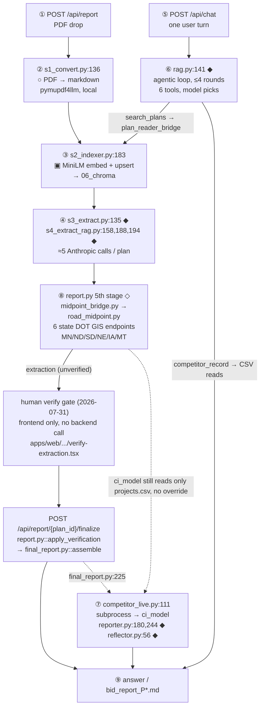

# CSI Bid Intelligence — System Architecture

**Audience:** Mochen (faculty advisor). **Scope:** the whole system, not one branch.

Every path and line number below was read off the current tree and verified with `git ls-files`.
Where behaviour could not be determined by reading the code, the row says **UNVERIFIED** rather than
guessing.

Every column except `Job — why` is derived from the code and verified against it. The `Job — why`
column is the design intent behind each step, written by hand rather than read off the source.

---

## 1. The call sequence — where every external call happens

This is the centre of the document. **The question it answers is "where is the API call, and when?"**

The system has **two entry points**, and they do different things. Every external call below is
marked in place. `○` = pure file transform, no call. `▣` = **local** model, no network.
`◆` = **external Anthropic API call**. `◇` = **external non-Anthropic HTTP call**.



**Changed 2026-07-31: the PDF drop is two phases, not one call.** `POST /api/report` used to run extraction *and* assembly (including the competitor-intel subprocess) in a single blocking request. It now stops after extraction and returns it unverified for the human verify gate; a second call, `POST /api/report/{plan_id}/finalize`, is what actually triggers `assemble()` and therefore `SUB`. The one exception: a re-drop of content that was **already** verified before skips the gate and goes straight to `FIN`'s work inline within the first call (§1.1 below).

### 1.1 Path A — the PDF drop (`POST /api/report`, then `POST /api/report/{plan_id}/finalize`)

**Phase ① — extraction.** Driven by `apps/api/backend/report.py::process_pdf` (`:93`). The CLI
equivalent is `pipelines/plan_reader/run.py`. Stages 1-9 below are all `process_pdf`; nothing past
stage 9 runs yet. `app.py`'s `report()` handler (`app.py:259-283`) returns the result as
`{"ok": true, "extraction": rep}` — UNLESS this exact PDF content was already verified in a prior
call, in which case `process_pdf`'s cache hit (`report.py:100-107`) returns a payload with
`verified: true` already set, and the handler skips straight to calling `assemble()` itself
(`app.py:278-279`) and returns `{"ok": true, "final": final}` instead — the pre-2026-07-31 behavior,
preserved for that one case.

| # | Stage | File : line | Call type |
|---|---|---|---|
| 1 | Convert PDF → markdown | `s1_convert.py:136` (`pymupdf4llm.to_markdown`), pdfplumber back-fill `:161` | `○` pure |
| 2 | Detect document type | `lib.py:450-487` (`detect_doc_type`) → `addendum` / `plan_set` / `proposal` / `contract_forms` | `○` pure |
| 3 | Section + chunk | `s2_indexer.py:119` → `lib.page_sections` (`lib.py:363`) | `○` pure |
| 4 | Embed + store | `s2_indexer.py:183` `collection.upsert` | `▣` **local** MiniLM (`lib.py:206`), writes `06_chroma` (`lib.py:52`) |
| 5 | Whole-doc extract | `s3_extract.py:135` `client.messages.create` | `◆` **1 call**, `claude-sonnet-4-6`, `temperature=0` |
| 6 | RAG extract — scalars | `s4_extract_rag.py:188`, preceded by retrieve at `:187` | `◆` **4 calls** (4 query groups, `:36-50` — includes the route/milepost/gross-length group added for the midpoint feature) |
| 7 | RAG extract — special reqs | `s4_extract_rag.py:194`, retrieve at `:193` | `◆` **1 call** |
| 8 | RAG extract — gotchas | `s4_extract_rag.py:158`, retrieve at `:154` | `◆` **1 call** over the 20-type taxonomy |
| 9 | Midpoint lookup | `midpoint_bridge.py::compute_midpoint`, called from `report.py`'s 5th stage (`report.py:139-157`) | `◇` **0-6 calls** to state DOT GIS REST APIs (MN/ND/SD/NE/IA/MT); skipped entirely if `route_number`/`begin_milepost`/`total_gross_length` are blank or `state` isn't one of the 6 |

**≈6 Anthropic calls per plan**, all through one shared client (`s3_extract.py:131`).

**Phase ① now also preserves per-field confidence.** `_val()` (`report.py:58-60`) still unwraps
`{value, confidence, page}` down to the bare value for `identity`/`quantities` (unchanged, so nothing
downstream — `assemble`, `render_markdown`, exports — needed to change), but a new sibling
`_conf()` (`report.py:63-69`) pulls the confidence/page pair into a new `field_confidence` dict
returned alongside them, keyed the same way. This is what the verify-gate UI (phase ②, below) flags
low/medium-confidence fields with — that data used to be extracted and then thrown away.

**Phase ② — the verify gate, then assembly.** `apps/web/src/components/verify/verify-extraction.tsx`
shows the extraction (real 3-level confidence, not a mockup as of 2026-07-31) and lets the user
confirm or edit fields, plus enter `latitude`/`longitude` by hand if stage 9 came back null — this is
frontend-only, no backend call happens while the user is looking at it. Skip is always allowed:
coordinates don't feed the competitor-intel match for a freshly dropped plan (see the corrected §5
below), so nothing in *this* report is blocked by skipping.

Either way (confirm or skip) the frontend calls `POST /api/report/{plan_id}/finalize`
(`app.py:285-292`), body `{extraction, edits}`. The handler calls `report.py::apply_verification`
(`report.py:215-257`) — which overlays `edits` onto the extraction's `identity`/`quantities` **in
place** (the same JSON, not `corrections.py`'s separate sidecar file — see the note on that split
below), marks it `verified: true`, and writes it to the payload cache (`_payload_cache_path`,
`report.py:54-55`) keyed on `content_hash` (computed once in `process_pdf`, `report.py:98`, so
finalize never needs the original PDF file, only what phase ① already returned) — then calls
`final_report.py::assemble()` (`app.py:292`), which is where the competitor-intel subprocess
(`SUB` in the diagram above) actually fires.

**The payload cache moved.** Before 2026-07-31, `process_pdf` wrote the cache itself, right after
extraction. Now only `apply_verification` writes it — an extraction isn't cached until a human has
been through the gate, so `process_pdf`'s cache-hit check at the top of the function (`report.py:
100-107`) can never return an unverified payload. This is also why phase ① computes `content_hash`
up front instead of `apply_verification` needing the original file: the hash round-trips through the
frontend inside the `extraction` payload it already has in hand.

**Where a corrected value lives now has two answers, not one.** A field edited through the verify
gate (phase ②) is written into the SAME payload-cache JSON the auto-extracted quantities/identity
already live in — by explicit request, so a user-entered `latitude`/`longitude` or corrected
quantity is indistinguishable in storage from an auto-extracted one. A field corrected *later*,
through chat's `record_correction` tool, still goes into `corrections.py`'s separate per-plan sidecar
file and is merged in at render time by `assemble()` (unchanged — see below). These are genuinely
different use cases (verify-before-first-generation vs. fix-after-the-fact) and neither replaced the
other.

**Why stage 6–8 exist at all:** `s3_extract` truncates the document — `smart_truncate`
(`s3_extract.py:83-92`) keeps the first 60% and last 40% and **drops the middle**, which is exactly
where mid-document fields live. Stages 6–8 recover those fields by retrieving first, then grounding
the model in the retrieved excerpts.

**Retrieval is not an API call.** `retriever.retrieve` (`retriever.py:50`) runs
`collection.query(...)`, and MiniLM embeds the query **locally** inside that call. The only network
egress in the whole retrieve step is the synthesis call that follows it.

**The document-type branch — what is actually true.** Doc-type branching exists in the **ingest**
layer only (`lib.py:450-487`, consumed at `lib.py:375`, `:601-606`, `:609-614`). It does **not**
branch any prompt: `s3_extract.py` and `taxonomy.py` contain zero occurrences of `doc_type`, and one
prompt serves every document type. Two caveats worth stating rather than hiding:

- **The doc_type axis is wired but unpopulated.** `disposition_for` and `relevance_for` do
  exact-then-wildcard lookup against `05_knowledge/section_taxonomy.csv`, and **all 18 rows in that
  file carry `doc_type = "*"`**. Every lookup resolves through the wildcard today. The mechanism is
  built; the data has not been specialised.
- **`s4_extract_rag.py:186` is dead code.** The `map_pages` restriction fires only when a field
  declares `doc == "plan_set"`, and **no field in `schema.py` does** — `traffic_level`, which its own
  docstring (`:179-181`) names as the motivating case, is `doc="either"` at `schema.py:85`. The
  `map_pages` argument threaded in from `run.py:129` and `report.py:133` is therefore always
  discarded.

**Fallback behaviour on this path.** A malformed model response is caught at `s3_extract.py:140-144`
and returns `None`; every field then degrades to the empty cell at `s3_extract.py:110-111`. An
outright API failure is caught at `report.py:134`, classified by `_classify_read_error`
(`report.py:72-90`), and surfaces to the user as **`read_error` — "may be corrupt or an unsupported
format."** That message is misleading: an Anthropic outage is reported as a bad PDF. Non-fatal, but
it points the user at the wrong cause. `--no-llm` skips stages 5–8 entirely (`run.py:121`) while
still writing a row of empty cells (`run.py:138`).

### 1.2 Path B — one chat turn (`POST /api/chat`)

`apps/api/app.py:128-129` → `rag.py::agentic_answer` (`:100-192`). One `◆` call per round at
`rag.py:141`, up to `_MAX_STEPS = 4` (`rag.py:29`). The model picks tools; the code does not.

**A single turn reaches both subsystems** — this is the join:

| Tool | Reaches | How | Call type |
|---|---|---|---|
| `search_plans` | **plan_reader** | `tools.py:55` → `plan_reader_bridge.retrieve` (`:35`) → `retriever.retrieve` (`retriever.py:50`) | `▣` local embed against `06_chroma` |
| `competitor_record` | **the CI model** | `competitor_record.py:33-34` reads `data/processed/bidder_results.csv` + `projects.csv` | `○` pure pandas |
| `query_bid_history` · `find_projects` · `query_competitors` | the bid master | `bid_data.py:29`, `project_registry.py:69`/`:104`, `competitors.py:23` | `○` pure pandas |
| `record_correction` | disk | `corrections.py:55` — the only **write** tool | `○` pure |

`plan_reader_bridge.py` is a **shim, not a reimplementation**. It puts `01_pipeline/` on `sys.path`
(`:19-20`) and imports plan_reader's own `lib.py` and `retriever.py` in-process (`:22-23`), so the
backend and the pipeline share one collection, one on-disk store, and one embedder.

> **Correction to a claim worth not repeating.** *No chat tool reaches the CI subprocess.*
> `competitor_live` is absent from `tools.py`'s imports and unreachable from any tool. A chat turn
> touches the CI model's **static CSVs** via `competitor_record`, never its orchestrator.

### 1.3 The two joins are on different endpoints

This distinction is the thing most easily got wrong:

| Join | Endpoint | Route | CI reached as |
|---|---|---|---|
| **Chat join** | `POST /api/chat` | `search_plans` → bridge → Chroma **and** `competitor_record` → CSVs | static data |
| **Report join** | `POST /api/report/{plan_id}/finalize` (was `POST /api/report` before 2026-07-31 — see §1.1) | `app.py:292` `fr.assemble` → `final_report.py:225` `cl.live_report` → `competitor_live.py:111` | **live subprocess** |

By default the subprocess makes **no LLM call** — `--skip-llm` is appended at
`competitor_live.py:103-104` and `settings.ci_live_skip_llm` defaults on (`config.py:126`). With it
off, `reporter.py:180`/`:244` and `reflector.py:56` fire.

### 1.4 Where the midpoint skill inserts — built, on the emission side only

Box ⑧ is a real 5th stage now: `report.py::process_pdf` calls `midpoint_bridge.compute_midpoint`
right after the existing extract try/except closes (`report.py:134-157`, before the
archetype/quantities computation) and splices `latitude`/`longitude` into the `identity` dict that
phase ① returns (see §1.1 — as of 2026-07-31 this no longer means "before the payload is cached";
nothing is cached until a human has been through the verify gate). `schema.py` gained four RAG
fields (`route_number`, `begin_milepost`, `end_milepost`, `total_gross_length`) that feed it;
`midpoint_bridge.py` wraps `04_tools/road_midpoint/road_midpoint.py` in a fail-safe call (never
raises, returns `None` on any missing field, unsupported state, API failure, or timeout).

**`run.py` was deliberately NOT extended in this pass.** It already calls `s4_extract_rag.py` so a
CLI-ingested plan gets the four new extracted fields, but it never calls `midpoint_bridge` — so
CLI-ingested plans do not get `latitude`/`longitude` written into their per-plan JSON. Only plans
processed through live `POST /api/report` get automated coordinates today. Giving `run.py` the same
5th-stage call, to keep the CLI and the API on one sequence, is a small, flagged follow-up — not
done here.

**What this does NOT do**: feed coordinates into `ci_model`. See the corrected §5 below — that half
of the seam is unchanged.

### 1.5 Three orchestrations, three different kinds of thing

| # | Where | Kind | Who decides the order |
|---|---|---|---|
| 1 | `apps/api/backend/rag.py::agentic_answer` | **Dynamic** — a Claude tool-calling loop | The model, per turn |
| 2 | `pipelines/ci_model/06_reporting/agent/orchestrator.py` | **Fixed** — hardcoded 5-stage sequence | The code |
| 3 | `apps/api/backend/report.py::process_pdf` | **Fixed**, hardcoded 4-stage sequence | The code |

All three are orchestrated. Orchestration 1 is the chatbot, and it is the only one where a model
decides the order.

`pipelines/plan_reader/04_tools/` is **not** a fourth orchestration and does not belong in this
table. It is a set of standalone offline utilities that sit off the ingest path entirely (§4).

---

## 2. Orchestration 1 — the chat agent (DYNAMIC)

`apps/api/backend/rag.py`, function `agentic_answer` (lines 100–192). Called from
`apps/api/app.py:136`, inside the `POST /api/chat` endpoint (`app.py:128-129`). It is the only
caller.

This is a genuine agent loop, not a pipeline. All six tool schemas are sent on every turn
(`rag.py:145`, `tools=tools.SCHEMAS`); the model chooses which to call and in what order. The loop
runs at `rag.py:139` (`for step in range(_MAX_STEPS)`), executes every tool the model requested
(`rag.py:158-166`), feeds results back, and exits when the model stops asking for tools
(`rag.py:154`, `if final.stop_reason != "tool_use": break`). `_MAX_STEPS = 4` (`rag.py:29`).

| Step | Script called | Instruction / prompt given | Tools available | Job — why |
|---|---|---|---|---|
| 1 | `rag.py:115` | `_SYSTEM` (`rag.py:31-53`), the base system prompt | — | Sets the ground rules once, so every turn starts from the same instructions instead of me restating them per request. |
| 1a | `rag.py:117-122` | Appended only if a plan is open: *"the user just uploaded and is viewing plan `<id>`…"*, instructing `search_plans` scoping and `record_correction` on user-stated values | — | Scopes the search to the plan the user is actually looking at. Without it the agent searches the whole corpus and confidently answers about the wrong project. |
| 1b | `rag.py:123-127` | Appended if corrections exist: *"User-confirmed values for this plan (PREFER these over the extraction)"* | — | A person correcting a value should outrank the extraction. This is how a human overrides the model without me retraining or re-running anything. |
| 2 | `rag.py:141-147` | The assembled system prompt + conversation history | All 6, every round | The actual decision point. I hand over every tool and let the model choose, because the questions people ask vary too much to hard-code a sequence. |
| 3 | `rag.py:162` `_execute_tool()` | — (model-supplied arguments) | dispatches by tool name | Runs whatever the model picked and hands the result back. Tool logic lives outside the loop so I can add a tool without touching the loop. |
| 4 | `rag.py:154-155` | — | — | Ends the turn once the model stops asking for tools. The step cap exists so a confused model cannot loop forever. |

The six tools (`apps/api/backend/tools.py:80-86`, exposed as `SCHEMAS` at `tools.py:89`):

| Tool | What it reaches |
|---|---|
| `search_plans` | the Chroma index of plan text |
| `query_bid_history` | the historical bid corpus |
| `find_projects` | project lookup |
| `query_competitors` | competitor records |
| `competitor_record` | a single competitor's detail |
| `record_correction` | writes a user-confirmed value back |

`record_correction` is the only tool in this chat loop that writes. It is no longer the *only* route
a project's latitude/longitude can enter the system through, though — as of 2026-07-31 the
verify-gate's finalize step (`report.py::apply_verification`, §1.1) is a second, earlier one, for a
plan that's still being reviewed for the first time rather than already generated. See §5.

---

## 3. Orchestration 2 — the competitor report agent (FIXED)

`pipelines/ci_model/06_reporting/agent/orchestrator.py`, function `run_report` (defined line 131).

Despite living in a directory called `agent/`, no model chooses anything here. The sequence is
straight-line Python with literal `[1/4]`…`[4/4]` stage banners. The LLM is called *inside* two of
the stages to write prose; it never decides control flow.

**How it is invoked.** `apps/api/backend/competitor_live.py::generate` (line 80) builds a command at
lines 97–104 and runs it as a **subprocess** at line 111, with `cwd` set to the repo root. There are
no Python imports between `apps/` and `pipelines/`. It communicates by CSV paths on the command
line and a written report file on disk.

```
--project-key --predictions --model --registry --bidder-results --output-dir --quiet [--skip-llm]
```

`--project-key` takes a `project_natural_key` (e.g. `MN_STEARNS_CO_MELROSE_2023-08-03`). This flag
was `--job-id` before 2026-07-28; `job_id` itself (CSI's local CSV row id, renumbered by
row-sort-position on every regeneration, never a stable identifier across pipeline runs) was
removed entirely on 2026-08-01.

| Step | Script called | Instruction / prompt given | Tools available | Job — why |
|---|---|---|---|---|
| 1 Planner | `agent/planner.py::plan` (called `orchestrator.py:225`) | none — pure ranking logic | `classify_threat` (`planner.py:13`) | Decides which competitors are worth analysing before spending anything on them. Pure ranking, no model call, because the logic is identical every run. |
| 2 Executor | `agent/executor.py::execute_all` (called `orchestrator.py:232`) | none — fixed calls, not model choice | `predict_and_explain`, `get_competitor_profile`, `generate_narrative` (imported `executor.py:18-20`) | Runs the analysis for the competitors the planner chose. Calls are fixed rather than model-chosen because the report has the same shape every time. |
| 3 Reflector | `agent/reflector.py::reflect` (called `orchestrator.py:244`, per analysis) | LLM prompt built in `reflector.py`; call at `reflector.py:56` | — | A second pass that checks the output before it becomes a report. This is where a model earns its place: judging quality, not following steps. |
| 4 Reporter | `agent/reporter.py::build_report` (called `orchestrator.py:252`) | LLM prompts at `reporter.py:180` (exec summary) and `:244` (recommendations); static fallbacks at `:190`, `:254` | — | Turns numbers into the language a bidder actually reads. The static fallbacks matter, because the report still renders if the model call fails. |
| 5 Export | `tools/export_report.py::export_report` (called `orchestrator.py:262`) | none — file write | — | Writes the file. Deliberately last and deliberately dumb, so a formatting problem cannot corrupt the analysis. |

**Inputs, all read as CSV by path:**

| File | Read at |
|---|---|
| `ranking_predictions.csv` | `orchestrator.py:161` (default `:35`) |
| `competitor_name_registry - name_variants.csv` | `orchestrator.py:56`, `:91` (default `:41`) |
| `data/processed/bidder_results.csv` | `orchestrator.py:57`, `:96` (default `:44`) |
| `data/processed/projects.csv` | `orchestrator.py:171-173` (default `:47`) |
| model JSON | `orchestrator.py:197` |

This is the seam. It reads `usecols=["project_natural_key", "mix_tons", "project_latitude",
"project_longitude"]` and loads the coordinates into `project_info["lat"]/["lon"]`. Line numbers
in this section predate both the 2026-07-28 job_id → project_natural_key migration and the
2026-08-01 removal of the `job_id` column/concept entirely (which shifted lines again); treat them
as approximate until someone re-checks against current `orchestrator.py`.

> **Correction to an earlier note:** `orchestrator.py:173` *consumes* coordinates; it does not
> compute the pit-distance features. Those are built upstream at
> `pipelines/ci_model/01_candidates/build_pit_features.py:327` and arrive pre-computed inside
> `ranking_predictions.csv`. The feature names are `nearest_open_pit_miles`,
> `nearest_unknown_access_pit_miles`, `nearest_accessible_pit_miles`,
> `nearest_owned_or_restricted_pit_miles`, `nearest_knife_river_pending_pit_miles`.

---

## 4. Orchestration 3: the plan_reader ingest (FIXED)

**The plan reader ingest is orchestrated.** The orchestrator is
`apps/api/backend/report.py::process_pdf` (`:93`), and it runs a fixed four-stage sequence:

| # | Stage | Call site | Module |
|---|---|---|---|
| 1 | Convert | `report.py:120` | `01_pipeline/s1_convert.py`: `convert.convert_pages(pdf_path)` |
| 2 | Ingest / index | `report.py:124` | `01_pipeline/s2_indexer.py`: `indexer.ingest_pdf(...)` |
| 3 | Whole-doc extract | `report.py:131` | `01_pipeline/s3_extract.py`: `extract.fill_extract_fields(...)` |
| 4 | RAG extract | `report.py:133` | `01_pipeline/s4_extract_rag.py`: `extract_rag.fill_rag_fields(...)` |

The order is hardcoded in `process_pdf`'s body; nothing chooses it at runtime. It is entered from
`apps/api/app.py:269` (`report_svc.process_pdf`, via `run_in_threadpool`) when a PDF is posted to
`/api/report`. §1.1 tables the same path at finer grain, down to the individual model calls.

**It caches by content hash.** `_payload_cache_path` keys the assembled payload on
`convert._hash(pdf_path)` (`report.py:47`); a hit short-circuits at `report.py:82-83` and returns
before stage 1, skipping convert, ingest and both extraction passes. The payload is written back at
`report.py:152`. Re-dropping a seen PDF under a new filename therefore still hits, because the key
is the bytes, not the path.

**`run.py` is the same sequence as a CLI.** `pipelines/plan_reader/run.py` calls the identical four
functions in the identical order (`:92`, `:112`, `:127`, `:129`) and imports the same four modules
(`run.py:35-38`, matching `report.py:24-27`). Its docstring calls it "the Plan Reader's one-command
driver." It exists to inspect one plan locally with an openable artifact at every step; `report.py`
is the same read path invoked programmatically, minus the file writing.

### 4.1 `04_tools/`: offline utilities, not the ingest path

Scoped correctly, there is still a real finding here, and it is narrower than it once read:
**`pipelines/plan_reader/04_tools/` has no orchestrator.**

These are standalone CLI utilities run by hand. Nothing sequences them, and no artifact in the repo
defines an intended order. **They are not on the ingest path**: `run.py` wires up `01_pipeline/`
only (`run.py:32-40`) and never references `04_tools`, and neither does `report.py`. That is
correct rather than a gap: `01_pipeline/` **is** the ingest, and `04_tools/` is corpus-level offline
work alongside it.

The numbering is a reading order, not an execution order. There is **no `03` and no `04`**, and six
prefixes are duplicated:

```
00_init_db.py                    07_gotcha_extract.py         09_build_material_crosswalk.py
01_bulk_convert.py               07_gotcha_prefilter.py       09_schedule_detect.py
02_split_sections.py             08_doc_type_flags.py         10_load_location_intelligence.py
05_parse_bid_schedule.py         08_material_universe.py      10_remap_buckets.py
06_derive_classification.py                                   11_load_section_intelligence.py
```

Plus unnumbered scripts in the same directory: `_scan_field_locations.py`, `boilerplate_scan.py`,
`gotcha_progress.py`, `rebuild_aggregates.py`, `retag_sections.py`, `open_db.sh`.

| Step | Script called | Instruction / prompt given | Tools available | Job — why |
|---|---|---|---|---|
| — | `04_tools/*.py`, run manually | **UNVERIFIED**, no orchestrator defines an order or an instruction | none, no agent exists at this layer | Offline corpus work, not ingest. These were written while I worked out what extracts cleanly from a plan set, so the numbers are a reading order for me and not an execution order, which is why there are duplicates and missing values. Their order is genuinely undefined, but that is a property of these utilities, not of the read path. |

### 4.2 The stages themselves

The four stages `process_pdf` and `run.py` both drive, in order:

| Step | Script called | Instruction / prompt given | Tools available | Job — why |
|---|---|---|---|---|
| 1 | `01_pipeline/s1_convert.py` | none — file transform | — | Gets the PDF into text and images. Everything downstream assumes this worked, so it stays a pure file transform with no model in it. |
| 2 | `01_pipeline/s2_indexer.py` | none — local MiniLM embedding, `s2_indexer.py:183` | Chroma | Builds the searchable index. Embeddings run locally rather than through an API, which keeps a 50k passage corpus free to index and re-index. |
| 3 | `01_pipeline/s3_extract.py` | LLM prompt; call at `s3_extract.py:135` | — | Pulls the specific fields a bidder needs off the plan. First point where a model is required, because plan layouts vary too much for rules. |
| 4 | `01_pipeline/s4_extract_rag.py` | delegates to `s3_extract.call_json` at `:158`, `:188`, `:194` | retriever | Retrieval-backed extraction for fields that are not on a predictable page. Falls back to searching the index when the direct read misses. |

**This is the answer to "where is the agent workflow for the plan reader?"** It is
`report.py:120-133`, entered from `app.py:269` (phase ① — see §1.1 for the 2026-07-31 phase split;
this 4-stage sequence itself is unchanged). There is a defined place to insert a new module, and it
is that sequence (see §1.4).

> **Correction to an earlier version of this document.** §4 previously declared plan_reader's
> orchestration to be NONE, and stated the ingest had no driver, no sequencer, and ran in an order
> that existed only in the operator's head. That was wrong. It generalised a true finding about
> `04_tools/` into a false one about the whole workstream, because every check for an orchestrator
> was run *inside* `pipelines/plan_reader/`, and the orchestrator lives in `apps/api/`, with the
> endpoint that receives the upload. §1.1 documented the correct sequence the whole time; the two
> sections were never reconciled. Same shape as rough edge 4: the check that was run verified a
> property adjacent to the one that mattered, namely "is there an orchestrator *in this directory*"
> rather than "is this sequence orchestrated *anywhere*".

---

## 5. The seam: where plan_reader and ci_model fail to meet — half bridged now

| | |
|---|---|
| **What plan_reader emits** | `route_number`/`begin_milepost`/`end_milepost`/`total_gross_length` (`schema.py`, RAG fields) — and, for MN/ND/SD/NE/IA/MT, an automated `latitude`/`longitude` computed from them via `midpoint_bridge.py` → `04_tools/road_midpoint/road_midpoint.py`, surfaced in the report's `identity` (`report.py`'s 5th stage). Two independent human-override paths as of 2026-07-31: the verify gate (`report.py::apply_verification`, §1.1) if the plan is still being reviewed for the first time — written straight into the same payload as the auto-extracted value; or a later `record_correction` of `lat_long` via chat, which overrides at render time (`final_report.py::assemble`) instead. |
| **What ci_model requires** | `project_latitude`, `project_longitude` — `orchestrator.py:173`, feeding the five `nearest_*_pit_miles` features |
| **What converts one to the other, INTO ci_model** | **Still nothing.** The bridge above lands coordinates in the *report*, not in `ci_model`'s input. |

**The consumption side is unchanged and deliberately untouched.** `orchestrator.py` still only
reads pre-computed coordinates from `data/processed/projects.csv` for historical projects already
matched by a `project_natural_key` (via `competitor_live.py::find_project_key`) — there is no CLI
flag or other mechanism to feed it an ad-hoc plan's coordinates, and doing so would mean editing
CI-team-owned orchestrator code or mutating their shared static CSV. A freshly uploaded plan that
isn't yet in the historical corpus still cannot get its coordinates into a competitor-prediction
run. This is a structurally separate, larger problem (predicting competitors for a project with no
historical `project_natural_key` at all), out of scope for the midpoint feature and not attempted
here.

For a plan the automated lookup can't resolve (unsupported state outside the 6, a field the model
couldn't find, or a state DOT API failure/timeout), a human has two ways to fill it in, depending on
when: **before the report is first generated**, the verify gate (§1.1) shows the missing
`latitude`/`longitude` and lets the user type them in directly — `report.py::apply_verification`
writes them straight into the payload, no separate override step at render time needed. **After** a
report already exists, typing coordinates into chat still works as before — `record_correction` →
`lat_long` alias map (`apps/api/backend/corrections.py:26`) — and that correction reaches the report
by being merged in at render time (`final_report.py::assemble`), not by mutating the cached payload.

---

## 6. Where the external API calls happen

**13 files** make a real outbound call: **10 call Anthropic**, 3 make non-LLM HTTP requests (2 to
the US Census TIGER endpoint, 1 — `midpoint_bridge.py` — to up to 6 state DOT GIS REST endpoints). A
further **6 files reach Anthropic indirectly**, through one of those 10, and are listed separately
below. Earlier drafts stated 18/16 by counting callers and call sites together.

Separately, **4 files** open a Postgres connection to Supabase. These are offline data-publishing
scripts, not part of either request path (`/api/report`, `/api/chat`) — none of them run inside a
user-facing call. See §9 for what they publish and why they're excluded from the counts above.

There is **no** OpenAI, Gemini, Cohere, Replicate, LangChain, LiteLLM, or boto3 anywhere in the
repo. Embeddings are computed **locally** (MiniLM via Chroma) and are not an API call.

**Only one of the 10 sits on the chat path** (`rag.py:141`). Retrieval and embedding are local, so
there is no second call for search or synthesis. A turn costs one request per round of the loop:
one if the model answers directly, plus one more each time it calls a tool and returns with the
result. The other nine call sites are per-document, offline tooling, batch, or disabled by default.

### Frequency — what actually drives cost

The file count is not the bill.

| When it fires | Call site | Cost note |
|---|---|---|
| **Every chat turn** | `rag.py:141` | the only billed call on this path |
| **Per document** | `s3_extract.py:135`, via `report.py:131` | once per PDF processed |
| **Offline tooling** | `04_tools/05_parse_bid_schedule.py:389`, `07_gotcha_prefilter.py:178`, `07_gotcha_extract.py:259`, `09_build_material_crosswalk.py:212` | run by hand; one-off corpus cost, not per user |
| **Batch API** | `07_gotcha_extract.py:625` | 50% of standard rate, async, polls up to 24h |
| **Evaluation only** | `retriever.py:88` `synthesize`, via `rag_report.py:148` and its own CLI | never runs in production. **Not** on the chat path: `plan_reader_bridge` exposes only `retrieve`/`build_context`, and `tools.py:55` calls `pr.retrieve` |
| **Off by default** | `ci_model` `reporter.py:180`, `:244`, `reflector.py:56`, `generate_narrative.py:232` | gated by `--skip-llm`, which defaults ON (`config.py:126`) |
| **Per document, non-LLM** | `apps/api/backend/midpoint_bridge.py`, via `report.py`'s 5th stage | up to 6 state DOT GIS calls per plan (MN/ND/SD/NE/IA/MT only); gated by `settings.midpoint_lookup_enabled`, skipped if route/milepost fields are blank |

Not billed at all: embeddings (local MiniLM), the US Census TIGER endpoint (free), the state DOT GIS
endpoints (free), and the entire frontend (`apps/web` makes no model calls).

### Anthropic — direct calls (10 files)

| Module | File | Line |
|---|---|---|
| `apps/api` | `backend/rag.py` | 141 `messages.stream` |
| `pipelines/plan_reader` | `01_pipeline/s3_extract.py` | 135 |
| | `01_pipeline/retriever.py` | 88 |
| | `04_tools/05_parse_bid_schedule.py` | 389 |
| | `04_tools/07_gotcha_extract.py` | 259; 625 `messages.batches.create` |
| | `04_tools/07_gotcha_prefilter.py` | 178 |
| | `04_tools/09_build_material_crosswalk.py` | 212 |
| `pipelines/ci_model` | `06_reporting/agent/reporter.py` | 180, 244 |
| | `06_reporting/agent/reflector.py` | 56 |
| | `06_reporting/tools/generate_narrative.py` | 232 |

### Anthropic — indirect (6 files)

These reach the API through another module or a subprocess.

| Module | File | Line | Via |
|---|---|---|---|
| `apps/api` | `backend/report.py` | 131, 133 | plan_reader extract modules |
| | `backend/competitor_live.py` | 111 | subprocess → ci_model orchestrator |
| `pipelines/plan_reader` | `01_pipeline/s4_extract_rag.py` | 158, 188, 194 | `s3_extract.call_json` |
| | `run.py` | 127 | `extract.fill_extract_fields` (`--no-llm` guards it) |
| | `03_evaluation/eval_extraction.py` | 140 | same (`--fresh`) |
| | `03_evaluation/rag_report.py` | 148 | `retriever.synthesize` (`--no-llm` guards it) |

### A new kind of outbound dependency, not HTTP: direct Postgres (2026-07-30)

The three tables below predate this connection type in this backend, so it doesn't fit the
LLM/non-LLM-HTTP split above. `apps/api/backend/ci_db.py` opens a plain `psycopg` connection to
Supabase's `scratch` schema — the CI-data admin endpoints (§9) are the first place this backend
talks to Postgres directly; every other read anywhere else in `apps/api` is a local CSV by path.

### Non-LLM external HTTP (3 files)

| Module | File | Line | Target |
|---|---|---|---|
| `data` | `clean_mn_pit_list.py` | 67 | US Census TIGER shapefile |
| | `archived/clean_mn_pit_list_pass1.py` | 45 | same |
| `apps/api` | `backend/midpoint_bridge.py` | via `road_midpoint.find_midpoint` | 6 state DOT GIS REST APIs (MN/ND/SD/NE/IA/MT) |

### Postgres (Supabase) connections (4 files) — offline, not on either request path

| Module | File | Direction | Schema |
|---|---|---|---|
| `data` | `push_supabase_bid_data.py` | write | `scratch` |
| `data` | `pull_registry_corrections.py` | read | `scratch` |
| `data` | `pull_supabase_table.py` | read | `scratch` or `public`, ad hoc |
| `pipelines/plan_reader` | `04_tools/publish_to_supabase.py` | write | `public` |

Full detail in §9.

### Builds a client or reads the key, but never calls (7 files)

Listed because they look like call sites and are not: `apps/api/backend/config.py:90-99`
(key loading), `apps/api/backend/tools.py` (schema definitions),
`pipelines/ci_model/06_reporting/agent/orchestrator.py:127-128` (constructs the client and hands it
to reporter/reflector), `pipelines/ci_model/06_reporting/agent/executor.py` (threads it through),
`apps/api/backend/plan_reader_bridge.py`, `pipelines/plan_reader/01_pipeline/lib.py:203-210`
(local MiniLM), `pipelines/plan_reader/01_pipeline/s2_indexer.py:183` (local embedding).

`apps/web` makes **no** LLM calls. Its `fetch` sites to this system's own backend are unchanged; as
of 2026-07-31 it also calls Google directly for the pit-list feature's map and geocoding — see §9.

---

## 7. Known rough edges

Stated factually. These are the honest answer to "are we wasting anything?" — the waste is not
storage, it is dependency classification, and it has failed silently every time.

**1. CI subprocess failures are invisible.** `apps/api/backend/competitor_live.py:113-122` returns
`None` on timeout, `CalledProcessError`, or any exception, and the caller falls back to a **stale
pre-generated report**. The API returns HTTP 200 with plausible competitive output while the
subprocess is dead. Documented at `apps/api/backend/config.py:56-60`.
*Any verification that CI works must prove the subprocess ran — process observation or an advanced
report mtime. A response returning proves nothing.*

**2. Subprocess stderr is truncated at 400 characters.** `competitor_live.py:117` cuts off the
exception line. Combined with edge 1, a real `FileNotFoundError` was hidden this way and only
surfaced by reproducing the command by hand. Fix: log the tail, not the head.

**3. Two artifacts a fresh clone cannot run without.** Both gitignored as regenerable:

| Artifact | Size | Recovery |
|---|---|---|
| `pipelines/ci_model/03_training/outputs/ranking_predictions.csv` | 94 MB | `pipelines/ci_model/README.md` |
| `pipelines/plan_reader/06_chroma/` | 1.5 GB | `pipelines/plan_reader/README.md` |

**4. Safety checks in this repo have repeatedly verified a property adjacent to the one that
mattered.** Five occurrences, each a different check, each passing while the real constraint went
untested:

| # | Decision | Property checked | Property that mattered |
|---|---|---|---|
| 1 | `.gitignore` rules | pattern matched the directory | rules were path-anchored to a layout that had moved |
| 2 | `data/processed/` routing | files looked generated | a fresh clone needed one of them to run |
| 3 | `03_training/outputs/` routing | directory looked uniformly derived | one file was runtime-required |
| 4 | `data/derived/outputs/` routing | provenance — authored vs generated | whether a fresh clone needs the file |
| 5 | root `reference/` relocation | **filename collisions** (`comm -12`, empty) | **nine scripts reference the path by CWD-relative literal** |
| 6 | "does plan_reader have an orchestrator?" (§4) | whether one existed **inside `pipelines/plan_reader/`** | whether the sequence is orchestrated **anywhere**. It is, in `apps/api/` |

Case 6 is the same error pointed at a directory rather than a file, and it produced a false negative
rather than a false positive: the answer looked absent because the search never left the module. The
orchestrator lives with the endpoint that receives the upload, which is where a request-driven
pipeline's driver belongs. **Scope the search to the behaviour, not to the folder that owns the
nouns.**

Cases 2–4 share one root cause: the `reference`/`derived` split classifies files by **how they were
produced**, while every failure turned on **whether a fresh clone needs the file to run**. The
unnamed category is *large-and-required*.

Case 5 is the same error in a different guard. The collision check was correct and passed; it simply
tested a different property than the one that would break. Had only that check been run, the move
would have shipped and looked verified.

The corrected rule is the fresh-clone test: **does a fresh clone need this file, at this path, to
run?** — not how the file was made, and not whether its name conflicts.

A related hazard, same family: **`pipelines/plan_reader/05_knowledge/project_archetypes.csv` and
`research/sweet_spot/outputs/2026-06-04_project_archetypes.csv` are different files and must not be
conflated.** The first holds the 5 archetype definitions built into the extractor prompt
(`lib.py:42`, `s3_extract.py:37`); the second is a sweet_spot analysis output joined against
`project_base.csv`. A basename grep hits both.

This is the direct answer to whether the project wastes anything. The waste is not storage; it is
dependency classification, and in all five cases it failed silently — no error, no warning, correct-
looking output.

**5. Root `reference/` — ✅ RESOLVED (directory removed).** It held three CSVs, all now gone:
`competitor_aliases.csv` (removed earlier — superseded by the name registry), and
`competitor_entities.csv` / `competitor_priority.csv` (removed — both were dead weight in the live
pipeline: `competitor_priority.csv` was an empty header the live candidate-generation script never
read, and `competitor_entities.csv` contributed zero unique pit-ownership resolutions beyond what
`bidder_results.csv` already covers). Their CWD-relative argparse defaults and read calls were
removed from `data/build_project_competitor_panel.py`,
`pipelines/ci_model/01_candidates/build_candidate_panels.py`, and
`pipelines/ci_model/01_candidates/build_pit_features.py`. `research/model1/build_candidate_panels.py`
(frozen research code, not runtime) still references the old paths.

Competitor identity resolution no longer uses fuzzy-match/manual-review scripts
(`fuzzy_company_match.py`, `rebuild_reviewed_competitor_registry.py` — both removed). The competitor
name registry (`pipelines/ci_model/01_candidates/outputs/competitor_name_registry - name_variants.csv`) is now
the single source of truth: `entity_resolution.apply_registry_mapping()` maps each `raw_bidder_name` straight
to the registry's `comp_name`, which **is** `competitor_unit_id` — there is no separate opaque ID.

**6. Three of the CI orchestrator's four path defaults point at a layout that never existed here.**
`_DEFAULT_PREDICTIONS` (`orchestrator.py:34-36`), `_DEFAULT_MODEL` (`:37-39`), and
`_DEFAULT_REGISTRY` (`:40-42`) default to `ci_model/competitor_prediction_model/…`, inherited from
an external clone (`git ls-files | grep -c competitor_prediction_model` → 0). `competitor_live.py`
passes them explicitly because the defaults were always wrong. This is a real constraint, not a
workaround. `_DEFAULT_BIDDER_RESULTS` (`:43-45`) and `_DEFAULT_PROJECTS` (`:46-48`) are correct.

**7. `sweet_spot` now has a home — ✅ RESOLVED.** It previously lived only in iCloud at
`02_modules/sweet_spot/`, a path referenced by executable repo code that could never resolve. It is
now imported at **`research/sweet_spot/`** (3.5 MB, 67 files), and
`pipelines/plan_reader/04_tools/06_derive_classification.py:37` reads
`research/sweet_spot/outputs/2026-06-04_project_base.csv` — verified to resolve and load
(1,591 rows × 46 columns).

All of `outputs/` is tracked deliberately, including the PNGs. Deciding per-file which derived
artifacts are "actually needed" is the judgement that failed in all five rows of rough edge 4; a
blanket rule needs no defending later and costs 1.5 MB. `notebooks/*.html` (4 files, 4.5 MB) is the
one exclusion — regenerable from the `.ipynb`/`.Rmd` sources, which are tracked, and nothing
references them. That ignore rule is scoped to `research/sweet_spot/notebooks/` rather than written
as a bare `*.html`, because an over-broad pattern is occurrence 1 in that same table.

> **Note, not a rough edge:** sweet_spot's own regeneration scripts still reference the
> pre-restructure input path — `scripts/2026-06-04_01_build_base_table.py:22` reads
> `HERE.parents[2]/"01_data"/2026-06-03_csi_bid_master.csv`, and that file now lives at
> `data/reference/`. The scripts have **not** been repathed, so `outputs/` cannot currently be
> rebuilt from source. This is why the tracked copies matter: "regenerable" is theoretical until
> those scripts are fixed.

---

## 8. What is not verified

- The intended execution order of `pipelines/plan_reader/04_tools/` — **UNVERIFIED**. No artifact in
  the repo defines it. This is scoped to those offline utilities only; the ingest path's order is
  verified and fixed (§4).
- Whether the duplicated numeric prefixes in `04_tools/` (two `07`s, `08`s, `09`s, `10`s) encode
  alternatives or successive versions — **UNVERIFIED**.
- The internal logic of `lib.page_sections` (`lib.py:363`), `lib.detect_doc_type` (`lib.py:450`),
  and `lib.detect_structure` (`lib.py:526`) beyond their branch lines and return values —
  **UNVERIFIED in detail**. Cited line numbers come from targeted reads, not a full read of those
  functions.
- Whether `s4_extract_rag.py:186`'s dead `plan_set` branch is unfinished work or an abandoned
  approach — **UNVERIFIED**. That it does not currently fire is verified (§1.1).
- The `Job — why` column is design intent, not a claim about the code. It states why each step
  exists, and unlike every other column it cannot be verified against the source.

---

## 9. CI-data admin endpoints — bid results / pit list / competitor registry (new, 2026-07-30)

Originally three in-product features so an estimator can maintain the data behind the
competitor-intelligence model directly, instead of hand-editing Supabase or the local CSVs the
batch scripts in `data/` work from — now four, with a Projects view added 2026-07-31 (below). Not
an orchestration in the sense of §1–§4 (no LLM in the loop anywhere in this path) — plain CRUD over
Supabase's `scratch` schema (`docs/DATA_ACCESS_SCRATCH.md`), reached from 4 `apps/web` pages through
one catch-all proxy route.

| Feature | Backend module | Endpoints |
|---|---|---|
| Bid results entry | `apps/api/backend/bid_results_admin.py` | `GET /api/ci-data/projects/missing-results`, `POST /api/ci-data/projects/{key}/bid-results` |
| Bid results table (view + inline edit, 2026-07-31) | `apps/api/backend/bid_results_admin.py` | `GET /api/ci-data/bid-results` (one row per bidder, joined to project), `PATCH /api/ci-data/bid-results/{project_natural_key}/{competitor_unit_id}` |
| Pit list CRUD | `apps/api/backend/pit_list_admin.py` | `GET/POST /api/ci-data/pits`, `PATCH/DELETE /api/ci-data/pits/{lat}/{lon}` |
| Competitor registry CRUD | `apps/api/backend/competitor_registry_admin.py` | `GET/POST /api/ci-data/competitors`, `POST /api/ci-data/competitors/consolidate`, `DELETE /api/ci-data/competitors/{comp_name}`, `DELETE /api/ci-data/competitor-raw-names/{raw_name_variant}` (2026-08-06) |
| Projects table (view + edit materials only, 2026-07-31) | `apps/api/backend/project_admin.py` | `GET /api/ci-data/projects`, `PATCH /api/ci-data/projects/{project_natural_key}/materials` — every other `bid_projects` column (identity, location, `project_type`) is read-only from this endpoint; unknown field names are rejected outright, not silently ignored |

All four share `apps/api/backend/ci_db.py` (connection + name normalization) and are wired into
`apps/api/app.py`. The frontend reaches them through one catch-all proxy,
`apps/web/src/app/api/ci-data/[...path]/route.ts`, forwarding method/query/body/status unchanged —
the same buffered-JSON shape as the existing `api/report/route.ts`, just generalized across every
verb instead of duplicated per resource.

**The bid-results table's inline edit cascades within one project — 2026-07-31.** Editing a bid
amount recomputes `bid_rank` for every bidder on that project (rank is relative, not a per-row
value); marking a row as winner clears the flag on the project's other rows first, same one-winner
rule `submit_bid_results` already enforced at insert time. Renaming a bidder re-resolves through the name registry and is blocked outright if the new
name already has a row on that project — no merge flow, same "block, don't silently collide"
pattern used elsewhere in this file (pit/competitor duplicate detection, below).

**Consolidate is registry-only — changed 2026-07-31, by explicit request.**
`competitor_registry_admin.consolidate()` renames the selected `raw_name_variant` rows' `comp_name`
in `scratch.competitor_name_registry` and stops there. It used to also cascade the rename into
`scratch.bid_results.competitor_unit_id` (joining on `raw_bidder_name`, not the old
`competitor_unit_id` value, specifically so that two raw names sharing one old `comp_name` — a real
case — wouldn't collide when only one of them was selected). That cascade has been removed.

The consequence: `competitor_unit_id` in `bid_results` *is* the registry's `comp_name` (rough edge 5
in the old architecture note) only held as an invariant while the cascade existed. Now, after a
consolidate, a raw name's registry row can point at a new canonical `comp_name` while its historical
`bid_results` rows still carry the *old* `competitor_unit_id` — the two go out of sync until the
next batch re-run of `entity_resolution.apply_registry_mapping()`
(`data/build_project_competitor_panel.py`) and a fresh `push_supabase_bid_data.py` load. Nothing in
the live admin path reconciles this automatically. `test_competitor_registry_admin.py::
test_consolidate_only_touches_the_selected_raw_name_and_leaves_bid_results_alone` now asserts both
halves: the registry-only rename still targets exactly the selected raw name, and `bid_results` is
never touched.

Duplicate-prevention rules (both hard-block-plus-soft-warning, `force` overrides the warning):
pits block on exact `(latitude, longitude)`, warn (not block) on a `name`+`county` match at
different coordinates; competitors block on an exact normalized-name match against `raw_name_variant`
*or* `comp_name`, warn (not block) on a `rapidfuzz` fuzzy match (threshold 80, reusing
`data/update_name_registry.py`'s existing `suggest_comp()` approach). Removing a competitor is
blocked outright (no reassignment flow) if any `bid_results` row still references it.

**Per-alias removal — added 2026-08-06.** The registry page groups rows by `comp_name` (e.g. 7-8
raw `raw_name_variant` aliases rolled up under one parent like "OMG Midwest"). Deleting the parent
via `DELETE /api/ci-data/competitors/{comp_name}` always removed every row in the group at once —
there was no way to drop a single alias while keeping the rest. `competitor_registry_admin.
remove_raw_name_variant()` (`DELETE /api/ci-data/competitor-raw-names/{raw_name_variant}`) adds
that: it deletes exactly one row and leaves every other row sharing that `comp_name` untouched. It
only inherits the parent-delete's `bid_results`-reference block in the one case where it's
equivalent to a full parent delete — this raw name is the *last* row for its `comp_name` and that
`comp_name` is still referenced in `bid_results`; otherwise it deletes unconditionally, same
"registry-only, doesn't touch `bid_results`" philosophy as `consolidate()` above. The competitor
registry page (`apps/web/src/app/competitor-registry/page.tsx`) exposes this as a trash icon on each
individual row (not just the group header), with the same two-step confirm/cancel as the
parent-level delete.

**Explicit scope boundary:** writes land in Supabase `scratch.*` only. There is no path back into
`ci_model`'s local training CSVs/parquet yet — same shape as §5's plan_reader/ci_model seam. See
`CLAUDE.md` rough edge 7 for the full current-status/verification writeup (what's been checked vs.
not, as of 2026-07-30).

### Google Maps — the first non-Anthropic, non-`apps/api` outbound call (2026-07-31)

The pit-list page (`apps/web/src/app/pit-list/page.tsx`) grew a required-field add form, a
registry-restricted `access_company` picker, and an interactive map — the last two need Google
Maps. Both call Google **directly from the browser**, not through `apps/api`:

| What | Where | Google API |
|---|---|---|
| County/state auto-fill from lat/long | `pit-list/page.tsx`'s `geocode()` | Geocoding (via `google.maps.Geocoder`, part of the Maps JS bundle) |
| All-pits map with markers | `apps/web/src/components/pit-list/pit-map.tsx` | Maps JavaScript API |

Both share one `<Script src="https://maps.googleapis.com/maps/api/js?key=...">` tag loaded once in
`pit-list/page.tsx` (`id="google-maps-script"`, `strategy="afterInteractive"`); `mapsReady` state
gates both consumers so neither touches `window.google` before it exists.

This is a deliberate exception to CLAUDE.md's "`apps/web` proxies to `apps/api` and nothing else"
rule, not an oversight — see CLAUDE.md's folder-responsibilities table for why (map tiles can't
reasonably be proxied through our own server). The key, `NEXT_PUBLIC_GOOGLE_MAPS_API_KEY` (repo-root
`.env.example` — `apps/web/next.config.ts` loads it directly via `dotenv`, so `apps/web` keeps no
`.env` of its own; `apps/web/.env.example` still exists but only as an optional per-machine
override, see `docs/SETUP.md`), is **public by design**: Next.js inlines any `NEXT_PUBLIC_*` var
into the browser bundle, and Google Maps keys are meant to be seen — they're secured by an
HTTP-referrer restriction in Google Cloud Console, not by secrecy. This is a different trust model
from every other credential in this repo (`ANTHROPIC_API_KEY`, `SUPABASE_TEAM_DB_URL`), which are
server-only secrets — don't apply that pattern here, and don't apply this pattern there.

The `access_company` picker itself does **not** call Google — it fetches
`GET /api/ci-data/competitors` (the existing registry endpoint, §9 above) and filters client-side;
Google is only geocoding and map rendering.

### "Find nearest pits" search — client-side only, no new endpoint (2026-08-06)

The pit-list page also grew an origin-based nearest-pit search, entirely in `apps/web`:

| Piece | File | Job |
|---|---|---|
| Origin picker (by bid project) | `apps/web/src/components/pit-list/project-midpoint-picker.tsx` | Typeahead over bid projects, lazy-loaded from the existing `GET /api/ci-data/projects` on first focus |
| Origin picker (by coordinates) | `pit-list/page.tsx`'s `applyCoordOrigin` | Validates a typed lat/long into the same `MapOrigin` shape |
| Distance calculation | `apps/web/src/lib/geo.ts::haversineMiles` | Computes `distanceMiles` for every pit already in `store.pits`, client-side, no request |
| Map marker | `apps/web/src/components/pit-list/pit-map.tsx` (`PitMap`'s `origin` prop) | Draws the origin as a distinct blue circular marker alongside the pit dots |

No new backend endpoint — the project picker reuses `GET /api/ci-data/projects` (§9 above), and the
distance math never leaves the browser. The one thing worth knowing if it's ever touched:
`geo.ts`'s `haversineMiles`/`EARTH_RADIUS_MILES` is a deliberate hand-copy of
`pipelines/ci_model/01_candidates/build_pit_features.py`'s `haversine_miles`/`EARTH_RADIUS_MILES`,
kept in sync by convention rather than shared code (one's TypeScript in `apps/web`, the other's
Python in `pipelines/`, and invariant 1 keeps those trees import-free of each other) — changing one
without the other means "nearest pit" on this page silently disagrees with what the
competitor-intelligence model actually scores off of.

---

## 10. Cloud data publishing (Supabase)

Two independent, one-way publishers copy local data into hosted Postgres (Supabase). **Neither is
read by the running application** — both exist so people outside this repo can query the data
directly, over a connection string, without a Python environment or this codebase.

| Publisher | Schema | Tables | Source | Trigger | Notes |
|---|---|---|---|---|---|
| `pipelines/plan_reader/04_tools/publish_to_supabase.py` | `public` | 8: `plans`, `materials`, `plan_metrics`, `gotchas`, `location_intelligence`, `material_crosswalk`, `bucket_hierarchy`, `section_taxonomy` | local `csi_v2.db` (SQLite), opened strictly read-only | manual, full-replace in one transaction | Not live — does not update when a new plan is dropped into the app. Full detail: `docs/DATA_ACCESS.md`. |
| `data/push_supabase_bid_data.py` | `scratch` | 4: `bid_projects`, `bid_results`, `competitor_name_registry`, `mn_pit_list` | `data/processed/*.csv` | manual, incremental upsert (`ON CONFLICT DO UPDATE`) keyed on `project_natural_key` / table-specific keys | Writable team workspace. `competitor_name_registry` is the one table meant to be edited directly by the client — blank `comp_name` rows are the signal for a human correction. Full detail: `docs/DATA_ACCESS_SCRATCH.md`. |

Two more scripts exist purely to read the `scratch` schema back out: `data/pull_registry_corrections.py`
(pulls the client's name-registry corrections into the local CSV, closing the loop) and
`data/pull_supabase_table.py` (generic ad-hoc table dump, exploratory only, not part of any
workflow).

**Distinct from §9 above.** §9's CI-data admin endpoints read and write Supabase's `scratch` schema
*live*, from the running app. The publishers here are one-way and manual — run by hand, not called
from `apps/api` — and `publish_to_supabase.py` targets the separate `public` schema. Neither
publisher is on the live request path (`/api/report`, `/api/chat`); `apps/api/backend/config.py`'s
data sources for those are exclusively local: CSVs under `data/processed/`, `pipelines/plan_reader/
csi_v2.db` (SQLite), and the local Chroma vector store. `competitor_live.py` invokes the CI model as
a subprocess against those same local paths.
