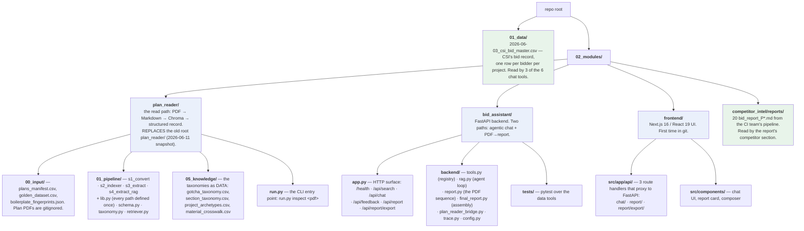
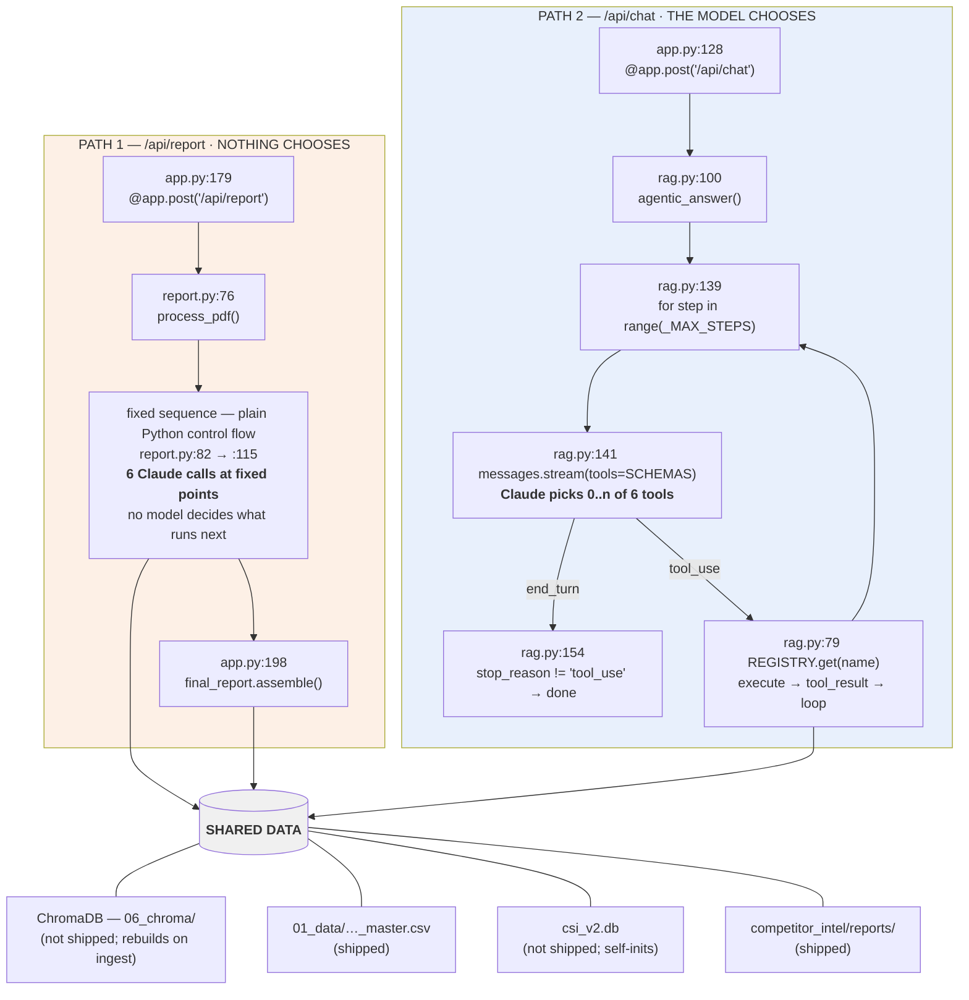
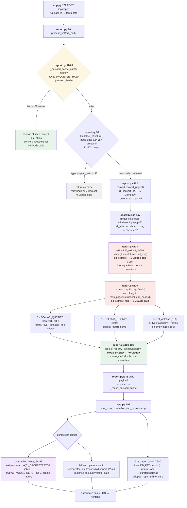
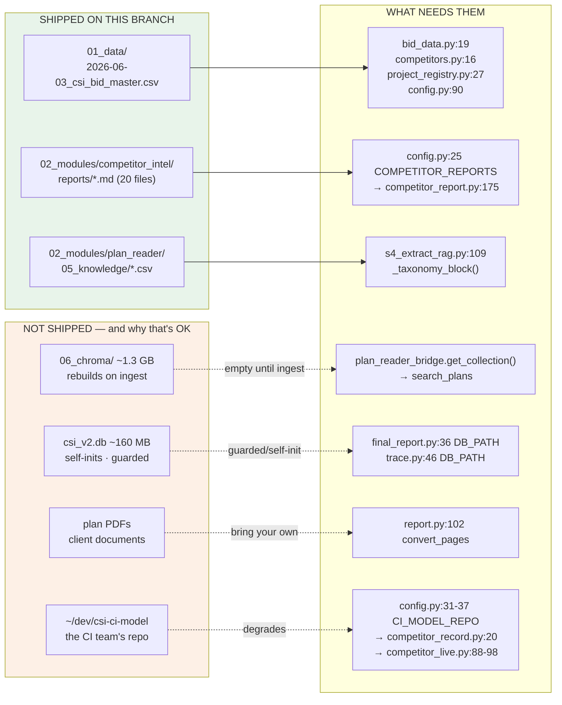

# ARCHITECTURE — `t/live-stack`

**Scope: only what this branch adds** — `01_data/`, `02_modules/`, and the frontend inside it.
It does not document `ci_model/`, `clustering/`, `data/`, `docs/`, `model1/`, `outputs/`,
`reference/`, `archived/`, `KTD_ProjectE.qmd`, or `run_cleaning_pipeline.py`. Those are the
team's and are documented by the team. Where this code touches theirs, the boundary is named and
this document stops there.

Every `file:line` below was read off **this branch** (`7329d52`), not carried over from an older
document. Line numbers moved when `app.py` was edited on this branch, so older notes are stale.

---

## Summary

This branch adds T's running stack: the current **Plan Reader** (`02_modules/plan_reader/`, which
replaces the root `plan_reader/` snapshot from 2026-06-11), a **FastAPI backend**
(`02_modules/bid_assistant/`) exposing a 6-tool agentic chat plus a PDF→report endpoint, and the
**Next.js UI** (`02_modules/frontend/`) that until now lived unversioned on one laptop. It also
brings the two data files that half the backend genuinely needs: `01_data/2026-06-03_csi_bid_master.csv`
and the CI team's 20 `bid_report_P*.md` under `02_modules/competitor_intel/reports/`.

**How is the Plan Reader orchestrated? It isn't.** There is no orchestrator, no graph, no planner:
`report.process_pdf` is a straight-line Python function that calls convert → index → extract → RAG
in fixed order, and the 6 Claude calls it makes are at fixed points that never choose anything.
Only the chat path is agentic.

> **Where the README landed.** The README written for this branch is at **`02_modules/README.md`**.
> The **root `README.md` is untouched** — it is still the team's `**Status**: ✅ **PHASE 1 COMPLETE**`
> document (line 3) about data cleaning and clustering, and it makes no reference to this stack.
> If you arrived at the repo root and expected to find this, that is why you didn't.

---

## 1. What this branch adds



Everything outside `01_data/` and `02_modules/` is untouched by this branch.

---

## 2. Two paths through the backend

One path is dumb and reliable. One path is agentic. They share data and nothing else.



The asymmetry is the point. If a report comes back wrong, the bug is in a specific line of
`report.py`. If a chat answer comes back wrong, the model may simply have picked the wrong tool.

---

## 3. The PDF pipeline



**6 Claude calls per cold plan.** 1 in `s3_extract` + 5 in `s4_extract_rag`. On a cache hit: zero.
On a plan-set-only PDF: zero. Every call goes through one helper, `s3_extract.call_json`
(`s3_extract.py:128`), pinned to `temperature=0` (`:135`) — the comment there records why: the
default 1.0 made the gotcha pass return 3 gotchas on one run and 0 on the next.

---

## 4. The 6 chat tools

Registered in `backend/tools.py:79-86`; `REGISTRY` at `:88`, `SCHEMAS` at `:89` are what get passed
to the Anthropic API. All six are live — none is dead code.

| # | Tool | Job | Reads |
|---|---|---|---|
| 1 | `search_plans` | Semantic search over ingested plan documents; returns cited excerpts. Schema is defined inline (`tools.py:31-50`), retrieval delegated to the bridge. | **ChromaDB** via `plan_reader_bridge.retrieve` → `lib.get_collection()` |
| 2 | `query_bid_history` | CSI's *own* record: how many bid, how many won, win rate, bid quality. | `01_data/2026-06-03_csi_bid_master.csv` (`bid_data.py:19`) |
| 3 | `find_projects` | Resolve a project by name, county/city/route, or an SP/CP/PCN/contract id. Fuzzy — this is what needs `rapidfuzz`. | master CSV (`project_registry.py:27`) + `plans_manifest.csv` (`:28`) |
| 4 | `query_competitors` | Who CSI bids against most, and how often each beats CSI. | master CSV (`competitors.py:16`) |
| 5 | `competitor_record` | One *named* competitor's bids/wins by year and county. Broader than the master CSV, which is CSI-centric. | **CI team's repo** — `CI_BIDDER_RESULTS` + `CI_PROJECTS_CSV` (`competitor_record.py:20`) |
| 6 | `record_correction` | Save a human correction for a plan (e.g. a lat/long the plan never states). Fed back into the chat system prompt at `rag.py:125`. | writes `bid_assistant/data/corrections/` (`corrections.py:22`) |

Tool #5 is the only one that degrades without an external checkout — see §7.

---

## 5. Where each prompt lives

| Claude call | Prompt | Defined at |
|---|---|---|
| Whole-doc extraction (1×) | `EXTRACTION_PROMPT` | `plan_reader/01_pipeline/s3_extract.py:45`, formatted at `:149`, sent at `:155` |
| RAG scalars (3×: traffic_level · phasing · dates) | `SCALAR_PROMPT` | `s4_extract_rag.py:57`, sent at `:188` |
| Special requirements (1×) | `SPECIAL_PROMPT` | `s4_extract_rag.py:70`, sent at `:194` |
| Gotcha classification (1×) | `GOTCHA_PROMPT` | `s4_extract_rag.py:80`, sent at `:158`; the 23-type taxonomy is injected by `_taxonomy_block()` (`:109`) from `05_knowledge/gotcha_taxonomy.csv` |
| Chat system prompt | `_SYSTEM` | `bid_assistant/backend/rag.py:31`; extended per-turn at `:118` (active plan) and `:125` (user corrections) |

All extraction calls funnel through `s3_extract.call_json` (`s3_extract.py:128`) — one place to add
prompt caching or batching. The chat call is the only `messages.stream`, at `rag.py:141`.

`retriever.py:88` also calls Claude (`synthesize()`), but **nothing in `bid_assistant` imports it** —
it's the standalone CLI path. It is not one of the 6.

---

## 6. Dependency map — what crosses a boundary



| Dependency | Needed by (`file:line`) | Ships? |
|---|---|---|
| `01_data/2026-06-03_csi_bid_master.csv` | `bid_data.py:19` · `competitors.py:16` · `project_registry.py:27` · `config.py:90` | **Yes** (2.54 MB) |
| `competitor_intel/reports/*.md` | `config.py:25` → `competitor_report.py:175` · `final_report.py` | **Yes** (188 KB, 20 files) |
| `plan_reader/05_knowledge/*.csv` | `s4_extract_rag.py:109` · `lib.py` taxonomy loaders | **Yes** |
| `plans_manifest.csv` | `project_registry.py:28` | **Yes** |
| `06_chroma/` (~1.3 GB) | `plan_reader_bridge.get_collection()` → `search_plans` | No — rebuilds |
| `csi_v2.db` (~160 MB) | `final_report.py:36` · `trace.py:46` | No — see §7 |
| plan PDFs | `report.py:102` | No — client data |
| `~/dev/csi-ci-model` | `config.py:31-37` → `competitor_record.py:20` · `competitor_live.py:88-98` | No — env-driven, degrades |
| `01_data/2026-06-08_crosswalk.csv` | `lib.py:32` `SOURCE_DATA` (only `03_evaluation/build_golden.py`, **not shipped**) | No — unused by shipped code |

---

## 7. Not shipped — and why nothing is broken

**`06_chroma/` (~1.3 GB) — rebuilds on ingest.** The vector store isn't in git. Dropping a PDF
runs `indexer.ingest_pdf` (`report.py:106`) and populates it. **Consequence: `search_plans` returns
nothing until you ingest at least one plan.** That is empty, not broken — do not file a bug. Ingest
a plan and it answers. `/health` reports `indexed_plans`, which is how you check.

**`csi_v2.db` (~160 MB) — self-initialises.** Two consumers, both safe on a fresh clone:
- `trace.py:46` — conversation capture. `_upsert_sqlite` (`trace.py:195`) runs
  `conn.executescript(_SCHEMA_SQL)` at `:209`, commented *"idempotent; self-initialize on first use"*,
  and the whole write is wrapped fail-safe so a capture error can never break the chat turn.
- `final_report.py:36` — the curated cross-corpus gotcha set. Guarded at `:84` and `:280` with
  `if not DB_PATH.exists(): return None`. The report then falls back to the **live** gotcha pass
  (`s4_extract_rag.detect_gotchas`), which is what a dropped PDF uses anyway.

  You lose the curated historical gotchas. You do not lose the report.

**`CI_MODEL_REPO` — degrades, doesn't crash.** `config.py:31` defaults to `~/dev/csi-ci-model` and
is overridable: `CI_MODEL_REPO=/path/to/clone`. Without it:
- `competitor_record` (tool 6) is unavailable — `competitor_record.py:27` checks `.exists()` first.
- Live competitor generation is skipped — `competitor_live.py:36` gates on
  `CI_ORCHESTRATOR.exists() and CI_PROJECTS_CSV.exists()`; the report falls back to the static
  `bid_report_P*.md` files shipped here.

**Plan PDFs** — client documents, gitignored. Bring your own.

---

## 8. Setup

```bash
# backend
cd 02_modules/bid_assistant
python3 -m venv .venv && .venv/bin/pip install -r requirements.txt
export ANTHROPIC_API_KEY=sk-ant-...      # or 02_modules/plan_reader/.env — see .env.example
.venv/bin/python -m uvicorn app:app --port 8010 --host 127.0.0.1
curl -s localhost:8010/health            # {"status":"ok","model":"claude-sonnet-4-6",...}

# frontend
cd 02_modules/frontend
npm install                              # .npmrc handles the peer conflict — see below
npm run dev -- -p 3002

# pipeline only, no UI
.venv/bin/python 02_modules/plan_reader/run.py inspect path/to/plan.pdf
```

**Only ONE backend at a time.** Two uvicorn instances writing the same persistent Chroma index
corrupt the HNSW segment. This has happened.

**Four dependency fixes were needed to make this run anywhere but T's laptop.** All four were found
by installing into a clean venv and running it — none is visible by reading the code:

| Missing | Needed by | Symptom |
|---|---|---|
| `pandas` | `bid_data`, `competitors`, `competitor_record`, `competitor_live`, `project_registry` | backend dies at import |
| `rapidfuzz` | `project_registry.py:23` (fuzzy resolution for `find_projects`) | backend dies at import |
| `python-multipart` | FastAPI multipart parsing for `POST /api/report` | **app starts fine**, 500s only on upload |
| `.npmrc` → `legacy-peer-deps=true` | `react-simple-maps@3.0.0` peers at react ≤18; this project is react 19.2.4 | `npm install` fails outright |

The first three are now in `requirements.txt`. The lockfile already paired react 19.2.4 with
react-simple-maps 3.0.0, i.e. it was generated with the flag — so without `.npmrc` it installed on
one machine and nowhere else.

**`BIDINTEL_API_URL`** — the backend URL is env-driven, not baked in. Identical pattern in all three
route handlers:

```
frontend/src/app/api/chat/route.ts:14           const BACKEND = process.env.BIDINTEL_API_URL ?? "http://127.0.0.1:8010";
frontend/src/app/api/report/route.ts:15         const BACKEND = process.env.BIDINTEL_API_URL ?? "http://127.0.0.1:8010";
frontend/src/app/api/report/export/route.ts:14  const BACKEND = process.env.BIDINTEL_API_URL ?? "http://127.0.0.1:8010";
```

Default works with no config if uvicorn is on :8010. Override to point at a deployed backend.

---

## 9. There is no central orchestration

Stated plainly, because the shape of the code invites the opposite assumption:

- **No orchestrator, no graph, no planner, no LangGraph.** Nothing coordinates the modules.
- **The report path is Python control flow.** `report.process_pdf` (`report.py:76`) calls
  convert → index → extract → RAG in fixed source order, with two early returns (cache hit `:87`,
  plan-set `:93`) and one `try/except` (`:100-119`). The 6 Claude calls sit at fixed lines. No model
  decides what runs next. `_archetype` (`:123`) is a deterministic rule over quantities — not a
  Claude call at all.
- **Only chat is agentic.** `rag.agentic_answer` (`rag.py:100`) is the sole place a model chooses:
  it loops `for step in range(_MAX_STEPS)` (`:139`), streams with `tools=tools.SCHEMAS` (`:145`),
  and exits when `stop_reason != "tool_use"` (`:154`).

The Master Agent described elsewhere in project docs **does not exist on this branch.**

---

## 10. Boundaries with the team's work

**Where this code reads the team's:** exactly one place, and it is external and optional.
`config.py:31-37` points at a *clone of the CI team's repo* (`~/dev/csi-ci-model`, overridable via
`CI_MODEL_REPO`) and reads `data/processed/bidder_results.csv` and `data/processed/projects.csv`,
and shells out to their `orchestrator.py` via `subprocess.run` (`competitor_live.py:88-98`). It
reads their **published outputs** — never their source in this repo. Nothing here imports
`ci_model/`, `clustering/`, `model1/`, or the root `data/`.

The 20 `bid_report_P*.md` under `02_modules/competitor_intel/reports/` are copies of that pipeline's
output, committed so the report's competitor section works without their repo checked out.

**Where the team's code could read this:** nothing does today. The natural seam is the Plan Reader's
per-plan JSON (`00_input/plans/<plan_id>/<plan_id>.json`), whose shape is defined once in
`plan_reader/01_pipeline/schema.py`. That is the typed interface if their model ever wants plan
fields. There is no shared identifier: their `P00xxxx` job ids do not appear in this data, which is
why `competitor_live.py` reverse-looks-up county+state+date to find a job id at all.

**A caveat worth carrying:** that county+state+date match can cross-match two projects let the same
day in the same county. It is a heuristic join, not a key.

---

## 11. Open issues

**`territory-map.tsx` is dead code and the sole cause of the peer conflict.**
`frontend/src/components/map/territory-map.tsx` imports `react-simple-maps`, and **nothing imports
`territory-map.tsx`**. That single unused component is the only reason `react-simple-maps` is a
dependency, and it is the only reason `.npmrc` exists. Delete the component, drop the dep, and
`.npmrc` can go with it — `npm install` would then work unaided.

**The midpoint skill needs a rasterization step that does not exist.**
Distance-to-aggregate needs a project midpoint. Most plans mark location only as a dot on a map
page. The pipeline currently produces `map_pages` — and `lib.py:529` documents exactly what those
are: *"1-based page numbers that are tabloid/ledger (the maps/plan set)"*. **Page integers. Not
images.** `s4_extract_rag.fill_rag_fields` passes them as a metadata filter to narrow retrieval
(`report.py:115` → `s4_extract_rag.py:186`), i.e. they scope a **text** search.

There are **zero `get_pixmap` calls anywhere in the repository.** No page is ever rendered to an
image, so nothing can look at a map. Any midpoint work needs a rasterization step
(page → pixmap → vision) that is not written yet. Knowing which page the map is on is not the same
as being able to see it.

**Also open:**
- `plans_manifest.csv` here is T's; your `run.py` runs will modify it.
- Cold-index flakiness is mitigated, not eliminated: `detect_gotchas` (`s4_extract_rag.py:146`)
  warms retrieval and retries on empty (`:159-160`), and `call_json` is pinned to `temperature=0`.
- The root `README.md` still describes only the team's Phase 1 and does not mention this stack.
